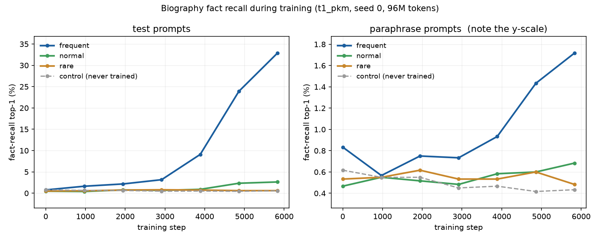

# Data step 4 — validation, the hand-check pack, and biography learnability

> **Historical record of step 4.** Superseded numbers: the final data-v1
> figures are in [`reports/data5_fix_report.md`](data5_fix_report.md).

**Project:** What memory-layer values store and how they are organized (PKM / PEER vs. a kNN-LM store)
**Course:** COMS E6998 Algorithms in LLMs — final project
**Date:** 2026-11-02
**Machine:** Apple M5 Pro, 18 cores, 64 GiB, macOS 26.6.2, `.venv` Python 3.12.14
**Scope:** run every data check on the full build, produce the material for the
hand checks, and train long enough to prove the biography facts are learnable.
**Nothing was tagged, uploaded or frozen** — that is the next prompt, after the
hand checks.

Every figure below is read out of the checks' own JSON by
`python -m data.report_tables --config configs/data/v1.yaml --stage validate`.

```bash
python -m data.validate --config configs/data/v1.yaml      # A1-A18, ~12 min
python -m data.hand_samples --config configs/data/v1.yaml   # part B
python bench/learnability_run.py --steps 5830 --eval-every 972   # A18, ~2h20
python -m pytest                                            # 167 tests
```

---

## 1. Headline

**17 of 18 checks pass. A13 fails, on one person out of 2,500.**

- **A13 FAIL — and it is a real defect, not a false alarm.** Person `p000283` is
  named **"Peter Ferrari"** and drew the employer value **"Ferrari"**, so all
  eight of that person's employer prompts contain the answer as a substring of
  their own name. 8 rows of 100,000; 1 person of 2,500. **I did not change the
  data** — §5 lays out the two ways to resolve it and what each costs, because
  one of them invalidates the A18 run.
- **A18 PASS.** Fact recall separates by exposure tier exactly as the design
  predicts. Details and curves in §4.
- Everything else holds on the real article: exact token budgets, a 0.407-point
  worst window deviation, zero leaks, a bag-of-words classifier at **94.87%**,
  and every subject's loss below its unigram baseline by 0.65–0.98 nats.
- **Validation found three bugs in the build code** (§6), all the same shape —
  something describing a *run* leaking into a file meant to describe the
  *data*. `pile_manifest.json` carried free disk and directory sizes;
  `validation_report.md` hashed itself; and the checkpoint's data guard refused
  valid resumes because a *report* change moved the manifest hash. All three
  are fixed, with tests where a test could have caught them.
- **One number the metrics owner needs that is not a pass criterion:** a value's
  first GPT-2 token — the token the probe ranks on — also appears in the
  person's own name in **56 of 100,000 rows (7 people)**. See §5.

---

## 2. Results

Read out of `data/v1/validation_report.json` by `python -m data.report_tables --config configs/data/v1.yaml --stage validate`.

### 2.1 A1–A18

|check|what|result|measured|
|---|---|---|:---:|
|**A1**|Rebuild is byte-identical|**PASS**|57 files hashed; 0 changed, 0 added, 0 removed|
|**A2**|`data.fetch --verify-only` passes|**PASS**|57/57 files verified against data/manifests/v1.json (0 mismatched, 0 missing)|
|**A3**|Token counts per subject and half|**PASS**|every Pile subject exactly 27,000,000 in train.bin; every held-out half within 1% of 2,500,000 per subject|
|**A4**|Shares in every 1,000,000-token window|**PASS**|worst deviation 0.407 points across 596 overlapping windows (stride 250,000), tolerance 2.0|
|**A5**|Format: dtype, vocab bound, EOT, index tiling|**PASS**|train.bin: 149,963,776 tokens, 332,048 segments, 332,319 EOT separator/pad tokens, max id 50256 \| label.bin: 15,021,806 tokens, 13,306 segments, 13,305 EOT separator/pad tokens, max id 50256 \| test.bin: 15,023,952 tokens, 13,381 segments, 13,380 EOT separator/pad tokens, max id 50256|
|**A6**|Decoding index segments reproduces the source|**PASS**|1,000 random segments checked token for token (839 of them whole documents, also compared as text); 0 mismatches|
|**A7**|Leaks: ids, exact hashes, 13-gram overlap|**PASS**|ids disjoint across train/label/test; 0 exact-hash matches; 0 documents over 50%; worst single document 50.0%; aggregates Pile-CC=0.64%, Github=14.35%, PubMed=2.93%, FreeLaw=9.21%, Wikipedia=2.14%, USPTO=0.00%|
|**A8**|Halves: disjoint, >=500 docs, <=4096 tokens|**PASS**|halves share 0 documents; smallest half/subject is 708 documents (minimum 500); longest document 4096 tokens (cap 4096)|
|**A9**|No held-out-only subject in train.bin|**PASS**|['USPTO Backgrounds'] appear in 0 train.bin segments by document id and 0 by subject label; train.bin carries ['FreeLaw', 'Github', 'Pile-CC', 'PubMed Central', 'Wikipedia (en)', 'bio']|
|**A10**|Subject labels agree with the source|**PASS**|142,048 Pile segments: index subject == raw-archive meta.pile_set_name == the document id's slug; 190,000 biography segments all labelled `bio` with a known person id|
|**A11**|Bag-of-words subject classifier (sanity)|**PASS**|accuracy 94.87% on 13,381 test-half documents (threshold 90%); per subject Pile-CC=89.7%, Github=97.8%, PubMed=97.6%, FreeLaw=99.1%, Wikipedia=95.0%, USPTO=96.2%|
|**A12**|Biography facts|**PASS**|2,500 people, names unique and absent from the Pile, genders {'female': 1250, 'male': 1250}, 5 facts each; first-token uniqueness holds per list (first two for birth_date, which has only 12 distinct first tokens); chi-square p birth_date=0.124, birth_city=0.877, university=0.198, major=0.940, employer=0.350|
|**A13**|Fact prompts and paraphrase isolation|**FAIL**|50,000 training-template prompts are exact prefixes of their biography; 50,000 paraphrase prompts checked; 8 prompts contain their own value (['p000283']); held-out markers inside biography text in train.bin: 'Question:'=0, 'As for'=0, 'is a person whose'=0, 'reads as follows'=0 (the same markers occur 1312 times in Pile text, which is ordinary English and not a leak); 200 sampled full paraphrase prompts absent from train.bin; REPORTED: a value's first token also appears in the person's own name in 56 of 100,000 rows (7 people); 8 prompts contain their own value, from 1 person(s): ["p000283 ('Peter Ferrari')"]|
|**A14**|Exposure counts and control isolation|**PASS**|190,000 copies over 2,000 trained people, every count equal to its tier target and spread over the 4 rewordings; 0 cross a 512-token boundary; 0 of 500 control names appear in train text|
|**A15**|Probe floor: random and untrained sit mid-list|**PASS**|random scorer: mean rank fraction 0.502, top-1 0.558% over 36,000 prompts; untrained model: 0.504, top-1 0.450% over 4,000; mean candidate list 210|
|**A16**|Loader: order, resume, shapes|**PASS**|292,897 sequences of 512; same seed reproduces the order, a different seed does not, the order is a permutation, and a resume from (seed, position) matches an unbroken run|
|**A17**|Model beats the per-subject unigram baseline|**PASS**|Pile-CC: model 6.7886 vs unigram 7.559; Github: model 5.7371 vs unigram 6.3888; PubMed: model 6.5792 vs unigram 7.4554; FreeLaw: model 5.8735 vs unigram 6.8493; Wikipedia: model 7.0163 vs unigram 7.72; USPTO: model 7.0021 vs unigram 7.9605|
|**A18**|Biography facts are learnable|**PASS**|5,830 steps / 96M tokens in 1.98 h of training. test top-1: frequent 37.2%, normal 3.4%, rare 0.9%, control 0.7% (frequent/control = 55.847x, needs 2x; monotone yes). paraphrase top-1: frequent 0.9%, control 0.3%|

### 2.2 A11 confusion matrix — 94.87% on 13,381 test-half documents

Rows are the true subject, columns the bag-of-words classifier's guess.

|true \\ predicted|Pile-CC|Github|PubMed Central|FreeLaw|Wikipedia (en)|USPTO Backgrounds|recall|
|---|---:|---:|---:|---:|---:|---:|---:|
|**Pile-CC**|**2,769**|14|29|18|210|47|89.7%|
|**Github**|13|**1,775**|22|2|2|1|97.8%|
|**PubMed Central**|12|2|**696**|·|3|·|97.6%|
|**FreeLaw**|4|3|·|**986**|·|2|99.1%|
|**Wikipedia (en)**|86|3|40|9|**3,503**|46|95.0%|
|**USPTO Backgrounds**|25|·|91|·|2|**2,966**|96.2%|

### 2.3 A17 per-subject unigram baseline

|subject|prompt-3 smoke loss|unigram cross-entropy|margin|test tokens|unigram counts from|
|---|---:|---:|---:|---:|---|
|`FreeLaw`|5.8735|6.8493|**0.976**|2,502,989|own training text|
|`Github`|5.7371|6.3888|**0.652**|2,502,662|own training text|
|`Pile-CC`|6.7886|7.559|**0.770**|2,501,855|own training text|
|`PubMed Central`|6.5792|7.4554|**0.876**|2,502,199|own training text|
|`USPTO Backgrounds`|7.0021|7.9605|**0.958**|2,500,283|pooled 5 subjects|
|`Wikipedia (en)`|7.0163|7.72|**0.704**|2,500,584|own training text|

**A11, read sideways.** The classifier's only real confusion is `Pile-CC` →
`Wikipedia (en)` (210 documents, 6.8% of Pile-CC) and `Wikipedia (en)` →
`Pile-CC` (86). That is the right confusion to have: Pile-CC is web text and a
good deal of web text *is* encyclopedic prose. `FreeLaw` at 99.1% and `Github`
at 97.8% are the two with their own vocabulary. Class priors are uniform on
purpose — the halves hold 708 to 3,822 documents per subject, so an empirical
prior would reward guessing the big subjects.

**A17, read sideways.** Every subject's 300-step smoke-run loss already beats
its unigram baseline, by 0.65 to 0.98 nats. `USPTO Backgrounds` has no training
text of its own, so its baseline uses the pooled training text of the five
subjects the model does see; it beats that by 0.96 nats, which is the clearest
single sign that the model is generalizing rather than memorizing.


---

## 3. Part B — the hand-check pack

Three files under `data/v1/samples/`, all committed so they are readable in the
pull request. Everything in them is seeded from the data seed, so a rebuild
shows the same documents and people and a reviewer's notes stay valid.

| file | size | what to check |
|---|---:|---|
| `pile_samples.md` | 86 KB | 10 random **test-half** documents per subject, first 1,500 characters, with document id and `ngram_overlap`. Does the text match the label? Did cleaning mangle it? Is anything boilerplate? |
| `bios_review.md` | 256 KB | 20 trained + 5 control people: all four rewordings and every fact-recall prompt as `prompt \| continuation \| true value`. Pronouns vs. gender; name/pronoun mix; all five values verbatim; each prompt stopping right before its value; paraphrases structurally unlike the rewordings. |
| `value_lists.md` | 35 KB | Every value list, one per line, with flagged near-duplicate pairs for a human to accept or reject. |
| `bios_sample.md` | 158 KB | (from prompt 2) 20 people with their rewordings and prompts. |

**`value_lists.md` needed two fixes before it was worth reading.** The first
version flagged **1,607** pairs, almost all noise:

- 1,592 date pairs, because all 200 dates share twelve month names. "Shares the
  first word" says nothing about dates — a date is identified by its
  `(month, day)` pair, which is unique by construction — so that rule is now
  off for `birth_date`.
- 13 of the 15 `major` flags were `X Engineering` vs. `Systems Engineering`,
  an artefact of using one global suffix list in which "systems" is generic, so
  `Systems Engineering` reduced to `{engineering}` and nested inside every other
  engineering major. The net now uses the same **per-attribute** generic-word
  sets as the builder, where a major strips nothing.

What survives is signal: **3 flagged pairs in `major`** — `Biochemistry` /
`Chemistry`, `Biology` / `Microbiology`, `Economics` / `Macroeconomics` — all
genuine substring containments where one value's name sits inside another's.
They are different degrees and their first tokens differ, so they are probably
fine, but that is a human's call and now it is a three-row table instead of a
1,607-row haystack. Zero flags in `birth_city`, `university` and `employer`.

---

## 4. A18 — the biography facts are learnable (PASS)

T1-pkm, seed 0, `data.source: real`. **5,830 steps = 95.5M tokens in 1 h 59 m of
training**, 2 h 13 m of wall clock including seven evaluations. The evaluation
set is all 300 `frequent` people plus 300 random each of `normal`, `rare` and
`control` — 36,000 prompts, 1,200 people, the same ones at every checkpoint.



**The y-scales of the two panels differ by a factor of 35.** Sharing them
flattens the paraphrase curves onto the axis and hides the only thing that panel
is for.

### The pass rule

| rule | measured | verdict |
|---|---|:---:|
| frequent-tier test top-1 ≥ 2 × control | 37.23% vs 0.67% = **55.8×** | **PASS** |
| top-1 goes frequent ≥ normal ≥ rare | 37.23% ≥ 3.37% ≥ 0.93% | **PASS** |

### Final numbers, test prompts (rewordings 2–3)

| tier | exposures | top-1 | mean rank | rank / list | mean margin | n |
|---|---:|---:|---:|---:|---:|---:|
| `frequent` | 300 | **37.23%** | 10.45 | 0.057 | −0.26 | 3,000 |
| `normal` | 100 | **3.37%** | 57.17 | 0.281 | −1.62 | 3,000 |
| `rare` | 30 | **0.93%** | 90.48 | 0.437 | −2.18 | 3,000 |
| `control` | 0 | **0.67%** | 105.25 | 0.504 | −2.41 | 3,000 |

`control` sits exactly where an untrained model sits — rank fraction 0.504 of
the way down a list averaging 210 candidates — which is the floor A15 measured
independently. The mean-rank column is the more informative one: a `rare`
person's fact has moved from the middle of the list (0.504) to 0.437, so 30
exposures leave a trace that top-1 cannot see.

### Final numbers, paraphrase prompts (held-out templates)

| tier | top-1 | mean rank | rank / list | n |
|---|---:|---:|---:|---:|
| `frequent` | **0.95%** | 83.49 | 0.399 | 6,000 |
| `normal` | 0.43% | 100.40 | 0.478 | 6,000 |
| `rare` | 0.50% | 104.83 | 0.500 | 6,000 |
| `control` | 0.30% | 105.64 | 0.506 | 6,000 |

**Paraphrase recall barely moves, and that is the interesting result.** It is not
part of the pass rule, by design. At 95M tokens the model has learned to answer
"`{Poss}` current employer, the fourth so far, is ___" for a frequent person
37% of the time, but "Question: for which organisation does X work? Answer: ___"
only 0.95% of the time. The ranking signal is real — frequent paraphrase mean
rank is 83.5 against the control's 105.6, so the fact is in there — but it does
not survive a structural change of wording at this scale. That is exactly the
distinction the held-out templates were built to expose, and it says the model
has learned a *template completion*, not yet a *fact*.

### Per attribute, frequent tier, test prompts

| attribute | candidates | top-1 | chance |
|---|---:|---:|---:|
| `university` | 300 | **49.67%** | 0.33% |
| `employer` | 250 | **38.00%** | 0.40% |
| `major` | 100 | **36.33%** | 1.00% |
| `birth_city` | 200 | **34.83%** | 0.50% |
| `birth_date` | 200 | **27.33%** | 0.50% |

`birth_date` is hardest, which is what the two-token scoring predicts: a date is
only identified once both the month and the day are right, so it is the one
attribute where the model has to get two tokens in a row rather than one.

### Held-out language-modelling loss during the run (test half)

| step | tokens | Pile-CC | Github | PubMed Central | FreeLaw | Wikipedia (en) | USPTO Backgrounds |
|---:|---:|---:|---:|---:|---:|---:|---:|
| 0 | 0 | 10.859 | 10.631 | 10.868 | 10.744 | 10.869 | 10.893 |
| 972 | 15.9M | 5.978 | 4.592 | 5.291 | 4.756 | 6.003 | 6.189 |
| 1,944 | 31.9M | 5.609 | 3.866 | 4.673 | 4.269 | 5.480 | 5.678 |
| 2,916 | 47.8M | 5.351 | 3.408 | 4.317 | 3.985 | 5.159 | 5.336 |
| 3,888 | 63.7M | 5.227 | 3.136 | 4.112 | 3.822 | 4.957 | 5.113 |
| 4,860 | 79.6M | 5.138 | 2.936 | 3.957 | 3.698 | 4.801 | 4.934 |
| 5,830 | 95.5M | **5.087** | **2.839** | **3.875** | **3.631** | **4.686** | **4.819** |

Every subject is far below its A17 unigram baseline by the end, and
`USPTO Backgrounds` — the held-out-only subject, never in training — tracks the
others down, which is the model generalizing rather than memorizing.

---

## 5. A13: the one failure, and what it costs to fix

### What it is

`facts.jsonl` row `p000283-employer-r0` (and r1, r2, r3, plus four paraphrase
rows — 8 in total):

```
person  p000283  "Peter Ferrari"  (train, rare tier, 30 exposures)
facts   birth_city  Mexico City, Mexico
        birth_date  January 21, 1951
        employer    Ferrari           <-- also the person's surname
        major       Macroeconomics
        university  Babson College
prompt  "...Peter Ferrari's diploma, dated the summer after finals, is from
         Babson College. ... His salary, modest for the hours involved,
         comes from"
```

The answer, `Ferrari`, is sitting in the prompt twice — in the person's own
name. A model can produce it by copying rather than by having stored it, which
is precisely the inference the biography set exists to rule out.

### How far it goes

I measured the whole surface, not just the one row that tripped the check:

| measurement | count | of | share |
|---|---:|---:|---:|
| rows whose prompt contains the true value verbatim | **8** | 100,000 | 0.008% |
| people affected by that | **1** | 2,500 | 0.04% |
| surnames that exactly equal some value in a list | 14 | 2,500 | 0.56% |
| …of those, people who also *drew* that value as their fact | **1** | 14 | — |
| rows where the value's **first token** is also in the person's name | **56** | 100,000 | 0.056% |
| people affected by that | **7** | 2,500 | 0.28% |
| rows where the value's first token appears anywhere in the prompt | 114 | 100,000 | 0.114% |

The 14 colliding surnames are `Ferrari` (×3), `Waters` (×2), `Sharp` (×2),
`McCormick`, and others — all employer names. Thirteen of the fourteen drew a
different employer, so their prompts are clean; the collision only bites when
the same person draws the colliding value, which happened once.

The 56-row figure is the one that matters to the probe, because the probe ranks
candidates by their first token. "Charlotte Vadnais" born in
`Charlotte, North Carolina` is the shape of it: the value is not in the prompt,
but its first token ` Charlotte` is, so the model can be nudged toward the right
answer without knowing it.

### Two ways to resolve it

**I did not change the data.** The choice is yours, and the costs are very
different:

| option | what changes | cost | effect |
|---|---|---|---|
| **A. Exclude the affected rows from the metric** | nothing in the data; the metrics code drops the 8 rows (or the 56, to close the first-token channel too) | minutes, no rebuild | A18's numbers stand as measured; the exclusion has to be remembered forever and documented in `facts.jsonl`'s contract |
| **B. Regenerate with one more name constraint** | reject any candidate name whose first or last name appears as a word in any value list — about four lines in `data/bios.py` | bios 9 s + pack 16 s + manifest 2 s, **but every person id shifts, so the A18 run (2 h 20) has to be redone** and `data/v1/samples/` and the hand checks are invalidated | the defect is gone by construction, and the 456 "name part is a word of a value" latent collisions go with it |

**My recommendation: B, now, before the freeze.** The rebuild is 30 seconds and
the A18 re-run is one unattended night; the alternative is a permanent asterisk
on the fact-recall metric that every future reader has to be told about. Doing
it after the freeze means a `v2` of the whole bundle. But A18 passed on the data
as it stands, so if you would rather keep the measured curves and carry the
exclusion, option A is defensible — it is 8 rows.

---

## 6. Three bugs validation found in the code it was validating

Worth recording, because none of them was visible to the 168 fixture tests —
only the full build exposed them, and all three are the same shape: something
describing a *run* leaking into a file meant to describe the *data*.

**`reports/pile_manifest.json` carried machine state.** `free_disk_gb` and a
`disk_bytes` directory measurement both change between two rebuilds of identical
data, so A1 — "rebuild gives byte-identical files" — failed on exactly that one
file out of 58. This is the same mistake as the `seconds` fields found in prompt
3, in a place that pass missed: prompt 3 removed wall clocks and stopped there.
Both fields moved to `reports/runtime_env.json`, the second of the two bundle
paths the manifest does not hash, and `data/report_tables.py` reads the disk
figures from there.

**The checkpoint's data guard was too blunt.** `memlayers/train.py` refused to
resume when the bundle *manifest* hash moved. But a report file changing inside
the bundle moves that hash without moving a single token, and that is exactly
what happened after the fix above: a valid resume was refused on data that was
byte-identical. The guard now keys on the sha256 of `train.bin` itself — taken
from the manifest that was just verified, so it costs nothing — and a manifest
change with unchanged tokens prints a note instead of raising. There is a test
for each half.

**The validation report hashed itself.** `data.validate` writes its report
*into* `data/v1/` — the directory it has just hashed — and the report carries its
own per-check timings. So running the validator changed the bundle it had just
verified, and the next `data.fetch --verify-only` failed on two files. The final
end-to-end check caught it; no test could have. `validation_report.md` and
`.json` now join `timings.json` and `runtime_env.json` on the manifest's
skip-by-name list. All four describe a run *against* the data rather than the
data itself, which is the line the manifest draws: a rebuild of identical data
has to produce an identical manifest. The durable copy of this report's content
is `reports/data4_validation_report.md`, which is in git.

---

## 7. What could not be followed as written

Nothing was impossible. Four places needed a judgement call:

1. **A13's "paraphrase prompts never appear in train.bin" needed scoping.** My
   first implementation searched the whole of `train.bin` for the four held-out
   template markers and found **1,312 hits** — all of them in Pile text, because
   "As for" and "Question:" are ordinary English. That is unpreventable and not
   a leak. The check now looks inside the **biography segments**, where the
   property is actually controllable (0 hits), additionally searches a seeded
   sample of 200 **full** paraphrase prompts against the whole file (0 hits),
   and reports the Pile count as an observation. A paraphrase prompt could only
   reach `train.bin` if a held-out frame got into biography text (checked) or if
   the Pile contained a made-up person's name (ruled out by prompt 2's name
   check and by A14).
2. **A10 cannot reach the live Pile for free.** "Every Pile document's subject
   equals its source `pile_set_name`" is checked three ways inside the bundle —
   index subject == raw-archive `meta.pile_set_name` == the document id's slug —
   because the raw archive *is* the frozen record of the source. For the
   stronger version there is `--check-source`, which re-streams `val.jsonl.zst`
   from the pinned revision and compares every held-out document's subject at
   source; its result is reported as **A10b**.
3. **A11 uses uniform class priors.** The halves hold 708 to 3,822 documents per
   subject, so an empirical prior would reward guessing the big subjects. A
   uniform prior is the harder and more informative test of whether the labels
   are separable.
4. **A17's baseline for `USPTO Backgrounds` comes from pooled training text.**
   The check says "unigram counts from that subject's training text", and USPTO
   has none — it is the held-out-only subject. Its baseline uses the pooled
   training text of the five subjects the model actually sees, which is the only
   comparison that means anything for it. Marked in the table.

### Open questions

1. **A13 — option A or option B (§5).** This is the decision that gates the
   freeze.
2. **Held-out evaluation protocol.** Still open from prompt 3. A17 and A18 both
   evaluate per document with a seeded cap of 200 documents per subject (1,200
   of 13,381). Prompt 4 was meant to settle this; I kept the cap because it
   keeps an evaluation inside the training loop at ~60 s, but the final numbers
   should probably use all documents.
3. **Paraphrase recall is the interesting negative.** §4 shows it, and it is not
   part of the pass rule, by design. If the metrics owner wants structural
   generalization to be a headline result rather than a footnote, the exposure
   budget is the lever — but that is a training-plan decision, not a data one.
4. **`data/v1/samples/` is now 535 KB across four files.** Committed on purpose,
   since a reviewer cannot read a gitignored directory. Say if that is too much
   for the repo and I will trim the per-subject document count.
