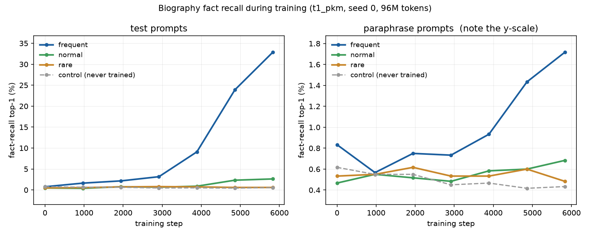

# Data step 6 — the templates now state the fact they carry

> **Current source for data v1.** The final figures for the dataset live here;
> steps 1–5 are historical records whose numbers this report supersedes.

**Project:** What memory-layer values store and how they are organized (PKM / PEER vs. a kNN-LM store)
**Course:** COMS E6998 Algorithms in LLMs — final project
**Date:** 2026-11-05
**Machine:** Apple M5 Pro, 18 cores, 64 GiB, macOS 26.6.2, `.venv` Python 3.12.14
**Scope:** fix the relation mismatch and the `{obj}`/`{subj}` grammar bug in the
sentence templates, rebuild, re-validate, re-run the learnability check, and
confirm every problem found in prompts 2–5 is still fixed. **Revised after the
audit:** the six templates §7.2 reported as still failing the rule, and the six
§7.3 called hard to read, were replaced too (§4.8), and everything below is
measured on that build.
**Part A only — nothing is frozen, tagged or uploaded.**

```bash
python -m data.bios        --config configs/data/v1.yaml   # 11 s
python -m data.bios_sample --config configs/data/v1.yaml
python -m data.pack        --config configs/data/v1.yaml   # 16 s
python -m data.hand_samples --config configs/data/v1.yaml
python -m data.manifest    --config configs/data/v1.yaml   # from a clean tree
python -m data.validate    --config configs/data/v1.yaml   # A1-A18
python bench/learnability_run.py --steps 5830 --eval-every 972   # A18
python -m pytest
```

---

## 1. Headline

- **Every sentence now asserts the fact it carries.** 53 of the 100 training
  templates stated something adjacent to the fact instead of the fact: an offer
  of a place instead of a degree, essay topics instead of the degree subject, a
  building's owner instead of an employer, "the date" with no word for which
  date. The rule is in the code now (`data/bios_data.py`, `RELATIONS`), next to
  the templates it governs (§2).
- **The five held-out question frames were ungrammatical.** They used `{obj}`
  where the subject belongs, so a pronoun biography read *"Question: what did
  **her** study?"*. They take `{subj}` now, and `check_templates` refuses the
  mistake (§3).
- **Nothing about any person moved.** Person ids, names, genders, tiers, target
  exposures and all five facts are **identical for all 2,500 people** —
  checked, not assumed — and every one of the 100,000 fact rows keeps its
  `fact_id`, `template_id`, `role` and `true_value`. Only sentence wording
  changed (§6).
- **A1–A18 all PASS** (§8). A18 was re-run on the new tokens with the same
  protocol and **the same 1,200 evaluation people and 36,000 prompt rows, proven
  identical by `fact_id`**: frequent-tier test top-1 **32.87% against a 0.57%
  control floor, 58×**, monotone across tiers (§9). Paraphrase recall **rose**,
  1.17% → 1.72% on the frequent tier, which was not expected — and the per-frame
  split says the rise is in the *"is on record as"* frame (4.40%), not in the
  question frame the grammar fix repaired (0.53%), which is what the relation fix
  predicts (§9.3).
- **190 tests pass** (§10), 11 of them new.
- `train.bin` sha256
  `fb29702d8171fc45e209e94d3aacaf4f0a3d81479a5b40860952178f3d6d5ec4`;
  bundle `data_sha256`
  `58ed83dd46ec985fac43f406705e1db9d1d9b0e6a1aceaa2dfea15f5c739e304`
  (§11 is the full freeze table).

---

## 2. The rule, in the code

`data/bios_data.py` now carries `RELATIONS` next to the templates, with the
comment that **every template, training and held out, must state this relation
directly, so that a reader who knows only that sentence knows the fact**:

| attribute | the relation every sentence must state |
|---|---|
| `birth_date` | the person was born on *{v}* |
| `birth_city` | the person was born in *{v}* |
| `university` | the person took a degree at (graduated from) *{v}* |
| `major` | the person's degree (major) is in *{v}* |
| `employer` | the person currently works for *{v}* |

**Not enough**, and the comment says so: where they grew up, lived or come from;
admission, an offer of a place, enrolment, study or library time without
graduating; essays, coursework or electives; offices, buildings, commutes or
badges with no employment stated; an unnamed "the date" or "the place".

### Why it matters for the measurement

The held-out probes ask the strict relation — *"is on record as **a graduate
of**"*, *"**an employee of**"*, *"having been **born on**"*. If the training
text only said *"was offered a place at Geneva College"*, a model that stored
that sentence perfectly would still be scored wrong on *"a graduate of"*, and
the prompt would be measuring whether the model guesses the relation, not
whether the memory layer stored the fact. That is the confound this step
removes.

---

## 3. The grammar bug

`{obj}` renders `her` / `him`. All five question frames used it as the subject:

| | |
|---|---|
| data 5 | `Question: what did {obj} study? Answer: {v}.` → *"Question: what did **her** study?"* |
| data 6 | `Question: what did {subj} study? Answer: {v}.` → *"Question: what did **she** study?"* |

The name rendering was always fine (`what did Ada Lovelace study?`), which is
why four review passes missed it: `mention(use_name=True)` fills every
placeholder with the name, so the bug only showed in the pronoun half, and the
pronoun half is where `{obj}` exists to be used.

Two guards were added to `check_templates()`, plus one from the "do not repeat"
list:

1. **No `{obj}` after a question word or auxiliary** —
   `\b(when|where|what|did|does|do|was|is)\s+\{obj\}`.
2. **Every template renders** with both pronoun sets *and* with a name, leaving
   no placeholder behind.
3. **The last three words before the value are distinct** inside each
   attribute's twenty training templates (the across-pool version was already
   enforced; this is the within-attribute one the prompt asked for).

Eleven new test cases cover them, including the two the prompt named: one that fails on
`"Question: what did {obj} study? Answer: {v}."` and one that renders all 120
templates for both genders, by name and by pronoun (480 renderings).

---

## 4. What changed, template by template

**59 templates: 53 of 100 training, 6 of 20 held out.** Replaced **in place**,
at the same list index, so `template_id`s, every person's template picks and the
held-out ids do not move.

`data/v1/samples/templates_rendered.md` is the page to read: all 120 frames,
each rendered with a female pronoun and with a male name against one fixed value
per attribute, with the data-5 wording printed underneath every changed one.

### 4.1 Four templates differ from the tables in the prompt

The prescribed wording failed two items on the "do not repeat" list. Both were
raised before the rebuild and settled by you; these four are the wording that
was built:

| | index | prescribed in the prompt | built, and why |
|---|---|---|---|
| `birth_city` | 9 | `{Poss} birth certificate names the birthplace as {v}.` | `{Poss} **own** birth certificate names the birthplace as {v}.` — the prescribed frame was 8 GPT-2 tokens, under the 9-token floor |
| `major` | 4 | `By graduation {subj} had specialized entirely in {v}.` | `By graduation **day** {subj} had specialized entirely in {v}.` — same reason; "almost entirely" was rejected as weakening the claim about the degree subject |
| `major` | 16 | `{Subj} completed formal training and graduated in {v}.` | `{Subj} completed formal training and **then** graduated in {v}.` — same reason |
| `employer` | 11 | `{Poss} desk, pension and monthly pay all come from {v}.` | `{Poss} desk, pension and **salary** all come from {v}.` — "monthly pay" contradicted the unchanged `employer[3]`, *"{poss} paycheck has arrived every second Friday"* |

### 4.2 `birth_date` — 7 of 20

| i | data 5 | data 6 |
|---:|---|---|
| 7 | `{Poss} earliest document is a birth notice dated {v}.` | `{Poss} earliest document is a birth notice giving the date of birth as {v}.` |
| 9 | `Every form {subj} has filled in since then repeats the date {v}.` | `Every application {subj} has ever filled in lists a birth date of {v}.` |
| 10 | `{Poss} birth was registered at the town hall three days after {v}.` | `{Poss} birth was registered at the town hall as having taken place on {v}.` |
| 13 | `{Poss} passport of ten years standing shows the date {v}.` | `{Poss} passport records the birth as falling on {v}.` |
| 15 | `Nobody in {poss} family has ever disputed the date {v}.` | `Nobody in {poss} family has ever disputed that the birth was on {v}.` |
| 18 | `A registrar's ledger carries {poss} name against the date {v}.` | `A registrar's ledger enters {poss} birth under the date {v}.` |
| 19 | `{Subj} arrived a full two weeks ahead of schedule, on {v}.` | `{Subj} was born a full two weeks ahead of schedule on {v}.` |

Index 10 also drops a stray fact: "registered three days after *March 4, 1987*"
put the registration on a date the sentence never names.

### 4.3 `birth_city` — 13 of 20

| i | data 5 | data 6 |
|---:|---|---|
| 1 | `Ask where {subj} grew up and the answer is always {v}.` | `Ask {obj} about a place of birth and the answer is always {v}.` |
| 2 | `{Subj} grew up a few streets from the center of {v}.` | `{Subj} was born a few streets from the center of {v}.` |
| 3 | `{Poss} family had lived for at least three generations in {v}.` | `{Poss} birth made a third generation of the family born in {v}.` |
| 4 | `{Subj} spent a childhood of bicycles and long summers in {v}.` | `{Subj} was born and spent a childhood of bicycles and long summers in {v}.` |
| 5 | `It takes ten minutes of conversation for {obj} to mention {v}.` | `It takes ten minutes of conversation for {obj} to mention being born in {v}.` |
| 7 | `{Subj} was raised by grandparents who never once left {v}.` | `{Subj} has the same city of birth as both parents, namely {v}.` |
| 8 | `An accent gives {obj} away as someone from {v}.` | `An accent gives {obj} away as someone born in {v}.` |
| 9 | `{Poss} earliest memories are of a flat above a bakery in {v}.` | `{Poss} own birth certificate names the birthplace as {v}.` |
| 10 | `{Subj} has never really felt at home anywhere but {v}.` | `{Subj} has lived in several countries since a birth in {v}.` |
| 13 | `Nothing in the first eighteen years of {poss} life happened outside {v}.` | `Nothing in the records casts doubt on {poss} birth in {v}.` |
| 14 | `{Subj} was brought up on the quieter side of {v}.` | `{Subj} was born on the quieter side of {v}.` |
| 16 | `{Subj} comes, as anyone can tell, from {v}.` | `{Subj} was born and bred, as anyone can tell, in {v}.` |
| 17 | `{Poss} childhood home stood on a narrow street in {v}.` | `{Poss} birth was recorded at the registry office of {v}.` |

### 4.4 `university` — 15 of 20

| i | data 5 | data 6 |
|---:|---|---|
| 0 | `{Subj} sat the entrance exams and was offered a place at {v}.` | `{Subj} sat the entrance exams and later graduated from {v}.` |
| 4 | `{Subj} earned a place, and then a scholarship, at {v}.` | `{Subj} earned a scholarship and then a degree at {v}.` |
| 5 | `{Poss} university, chosen over three others, was {v}.` | `{Poss} degree, from a university chosen over three others, was awarded by {v}.` |
| 6 | `{Subj} spent four years in the library at {v}.` | `{Subj} spent long hours in the library before graduating from {v}.` |
| 7 | `Illness interrupted a whole year of {poss} studies at {v}.` | `Illness slowed {poss} studies, but the degree still came from {v}.` |
| 8 | `{Subj} enrolled straight out of secondary school at {v}.` | `{Subj} enrolled straight out of secondary school and graduated from {v}.` |
| 10 | `Every reference letter {subj} has ever sent mentions {v}.` | `Every job application {subj} has sent lists a degree from {v}.` |
| 11 | `{Poss} lasting friendships and lasting debts both date from {v}.` | `{Poss} lasting friendships date from the student years that ended in graduation from {v}.` |
| 12 | `{Subj} was a student, and briefly a librarian, at {v}.` | `{Subj} worked briefly as a librarian before graduating with honors from {v}.` |
| 13 | `{Poss} transcript still sits in a drawer, stamped by {v}.` | `{Poss} degree certificate still sits in a drawer, stamped by {v}.` |
| 14 | `{Subj} trained under a famously demanding supervisor at {v}.` | `{Subj} wrote a degree thesis under a famously demanding supervisor at {v}.` |
| 15 | `{Poss} formal schooling came to an end for good at {v}.` | `{Poss} formal schooling ended for good with graduation from {v}.` |
| 16 | `{Subj} went on, with a scholarship in hand, to {v}.` | `{Subj} went on with a scholarship in hand to graduate from {v}.` |
| 17 | `{Poss} education continued, with a change of subject, at {v}.` | `{Poss} education was completed with a diploma from {v}.` |
| 19 | `{Subj} applied to four schools and got into {v}.` | `{Subj} applied to four schools and ended up graduating from {v}.` |

### 4.5 `major` — 13 of 20

| i | data 5 | data 6 |
|---:|---|---|
| 1 | `At the end of second year {subj} declared a major in {v}.` | `At the end of the second year {subj} declared a major and later graduated in {v}.` |
| 2 | `{Subj} switched course in the first year and settled on {v}.` | `{Subj} switched course in the first year and took the degree in {v}.` |
| 4 | `By the third year {subj} had specialized entirely in {v}.` | `By graduation day {subj} had specialized entirely in {v}.` |
| 6 | `{Subj} was the first in the family to study {v}.` | `{Subj} was the first in the family to earn a degree in {v}.` |
| 8 | `{Subj} focused, once the required courses were done, on {v}.` | `{Subj} finished the required courses and then majored in {v}.` |
| 9 | `{Poss} coursework for three straight years centered on {v}.` | `{Poss} coursework all counted toward the bachelor's in {v}.` |
| 10 | `{Subj} chose, against all advice, to study {v}.` | `{Subj} chose, against all advice, to major in {v}.` |
| 11 | `Every essay {subj} wrote that year was about {v}.` | `Every essay {subj} wrote was for a degree whose subject was {v}.` |
| 13 | `After the first year {poss} academic focus never shifted from {v}.` | `After the first year {subj} never considered leaving the major in {v}.` |
| 14 | `{Subj} dropped every elective that had nothing to do with {v}.` | `{Subj} dropped every elective and graduated with a major in {v}.` |
| 16 | `{Subj} trained formally and then by long practice in {v}.` | `{Subj} completed formal training and then graduated in {v}.` |
| 17 | `{Poss} timetable from the second year left room for little except {v}.` | `{Poss} crowded timetable all went toward graduating in {v}.` |
| 18 | `{Subj} spent three years and most of a fourth on {v}.` | `{Subj} spent three years and most of a fourth earning a diploma in {v}.` |

### 4.6 `employer` — 5 of 20

| i | data 5 | data 6 |
|---:|---|---|
| 7 | `{Poss} commute takes an hour each way to {v}.` | `{Poss} daily commute takes an hour each way to work for {v}.` |
| 9 | `{Poss} career has gone through one long stretch at {v}.` | `{Poss} career is now well into a long stretch of work at {v}.` |
| 11 | `{Poss} office is four floors up in a building owned by {v}.` | `{Poss} desk, pension and salary all come from {v}.` |
| 12 | `A week after graduating {subj} was hired by {v}.` | `After a few earlier jobs {subj} now works for {v}.` |
| 13 | `{Poss} security badge opens every door on three floors at {v}.` | `{Poss} staff badge opens every door on three floors at {v}.` |

Index 12 also removes a latent contradiction: *"a week after graduating"*
against `employer[19]`'s *"current employer, **the fourth so far**"*. Index 11
removes another: *"four floors up"* against `employer[13]`'s *"three floors"*.

### 4.7 Held out — 6 of 20

| attribute | data 5 | data 6 |
|---|---|---|
| `birth_date` | `Question: when was {obj} born? Answer: {v}.` | `Question: when was {subj} born? Answer: {v}.` |
| `birth_city` | `Question: where was {obj} born? Answer: {v}.` | `Question: where was {subj} born? Answer: {v}.` |
| `university` | `Question: where did {obj} take a degree? Answer: {v}.` | `Question: where did {subj} take a degree? Answer: {v}.` |
| `university` | `{Poss} profile reads as follows -- university attended: {v}.` | `{Poss} profile reads as follows -- degree awarded by: {v}.` |
| `major` | `Question: what did {obj} study? Answer: {v}.` | `Question: what did {subj} study? Answer: {v}.` |
| `employer` | `Question: where does {obj} work? Answer: {v}.` | `Question: where does {subj} work? Answer: {v}.` |

The university profile line asked about *attendance* while the other three
university probes ask about *graduation* — now all four ask one question.

### 4.8 The audit pass — twelve more templates

The first pass left 47 training templates untouched, and §7.2 reported six of
them as still failing the rule while §7.3 named six of the new ones hard to
read. All twelve were replaced in a second pass, again in place.

**The six the audit reported as still failing the rule** — their wording was
prescribed:

| attribute | i | before (data 5, untouched by the first pass) | now |
|---|---:|---|---|
| `university` | 18 | `{Subj} completed every requirement and then some at {v}.` | `{Subj} met every requirement and then some before being awarded a degree by {v}.` |
| `employer` | 0 | `{Subj} takes the same train to the same desk every day at {v}.` | `{Subj} takes the same train every day to a salaried job at {v}.` |
| `employer` | 16 | `{Subj} spends the better part of every working week at {v}.` | `{Subj} spends every working week on the staff of {v}.` |
| `employer` | 17 | `{Poss} team of six people sits on the top floor at {v}.` | `{Poss} job is on a team of six on the top floor at {v}.` |
| `major` | 7 | `{Poss} subject, the one every relative asked about, was {v}.` | `{Poss} degree subject, the one every relative asked about, was {v}.` |
| `birth_city` | 11 | `{Poss} birth records point without the slightest ambiguity to {v}.` | `{Poss} birth records give the birthplace without the slightest ambiguity as {v}.` |

Each one now states the relation rather than standing next to it: a degree
awarded, a salaried job, being on the staff, a job on a team, the degree
subject, the birthplace given as.

**The six that read badly** (§7.3) — reworded here, each still stating its
relation. The middle column is the first pass's wording, not data 5's; data 5's
is in §4.3, §4.5 and §4.6, and `templates_rendered.md` now shows all three
stages for these six:

| attribute | i | first pass | now |
|---|---:|---|---|
| `birth_city` | 7 | `{Subj} has the same city of birth as both parents, namely {v}.` | `{Subj} was born, as both parents were, in {v}.` |
| `birth_city` | 10 | `{Subj} has lived in several countries since a birth in {v}.` | `{Subj} has lived in several countries since birth in {v}.` |
| `birth_city` | 3 | `{Poss} birth made a third generation of the family born in {v}.` | `{Poss} birth was the family's third in {v}.` |
| `major` | 11 | `Every essay {subj} wrote was for a degree whose subject was {v}.` | `Every essay {subj} wrote was part of the degree earned in {v}.` |
| `major` | 17 | `{Poss} crowded timetable all went toward graduating in {v}.` | `{Poss} timetable was arranged entirely around a degree taken in {v}.` |
| `employer` | 13 | `{Poss} staff badge opens every door on three floors at {v}.` | `{Poss} staff badge is one of thousands issued to employees of {v}.` |

**One of my six was caught by the guard this step added.** `birth_city[10]` was
going to read *"…since **being born in** {v}"*, which duplicates the pre-value
wording of `birth_city[5]` (*"…to mention being born in"*) and would have left
two of that attribute's twenty frames reading alike in the three words before
the value. `check_templates` refused it before the build, so it reads *"since
birth in"* instead — which fixes the same thing the complaint was about (*"a
birth"* sounding like somebody else's) without the collision. That is the guard
doing the job it was added for, on the first new template written after it.

**59 of the 100 training templates now differ from data 5**: the 53 of the first
pass plus the six that pass had left alone. Six were changed twice. Indexes and
opener classes are unchanged throughout, so template ids and every person's
picks still do not move.

---

## 5. Do not repeat earlier problems

Every item measured on the real build. The measures are the ones that reproduce
data 5's own reported numbers, so the two columns are comparable: the frame
measure gives data 5 exactly its reported min 9 / mean 10.89; the opener measure
gives exactly 45/34/21; the aside measure gives exactly 16; the split measure
gives the pre-data-5 set exactly 5 and data 5 exactly 0.

| item | data 5 | data 6 | |
|---|---|---|:---:|
| answer leak: value verbatim in its own prompt | 0 | **0** | **PASS** |
| answer leak: ranking key in the person's own name | 0 | **0** | **PASS** |
| answer leak: ranking key in another of the person's values | 0 | **0** | **PASS** |
| template-word ranking-key rows (observation, must not rise) | 48 | **48** | **PASS** |
| values whose ranking key a template word hits | 4 | **4, the same four** | **PASS** |
| interrupting-comma asides, of 100 training templates | 16 | **14** | **PASS** |
| verb/object splits | 0 | **0** | **PASS** |
| "birthday … every year on *March 4, 1987*" wording | 0 | **0** | **PASS** |
| date wording that leaves the kind of date unnamed | 4 | **0** [^date] | **PASS** |
| contradictions across a person's four rewordings | 0 | **0** | **PASS** |
| British spellings | 0 | **0** | **PASS** |
| openers: person / possessive / other | 45/34/21 | **45/34/21** | **PASS** |
| new sentence-initial "The"/"A"/"An" openers | — | **0** (7 → 6) | **PASS** |
| shortest frame, GPT-2 tokens | 9 | **9** | **PASS** |
| biography share of the training budget (target 10%) | 9.71% | **10.10%** | **PASS** |
| biographies crossing a 512-token boundary | 0 | **0** | **PASS** |
| pre-value wording distinct within each attribute | not enforced | **enforced, 0 collisions** | **PASS** |
| pre-value wording of a held-out frame equals a training one | 0 | **0** | **PASS** |
| held-out marker inside training text | 0 | **0** | **PASS** |
| person ids / names / tiers / gender / facts moved | — | **0 of 2,500** | **PASS** |
| one person placeholder per template, `{subj}` recognized | yes | **yes** | **PASS** |
| every template opens with a capital or `{Subj}`/`{Poss}` | yes | **yes** | **PASS** |
| `{obj}` after a question word or auxiliary | 5 | **0** | **PASS** |
| A12 chi-square | PASS | **PASS**, p identical to data 5 to 3 d.p. | **PASS** |
| A1 rebuild byte-identical | PASS | **PASS**, 59 files, 0 changed | **PASS** |

### How each measure is defined

- **Frame tokens.** The template rendered with the female pronoun set, the value
  removed, the closing period counted: `len(encode(head.rstrip() + tail))`. Mean
  **10.89 → 11.51**, max 15 → 16, min 9 in both. The three frames that would
  have been 8 are §4.1.
- **Interrupting-comma aside.** A comma-delimited mid-sentence insertion
  (`, X ,`), excluding coordinations introduced by "and" (*"earned a place, and
  then a scholarship, at"*), which read as list items rather than asides.
  Excluding them is what reproduces data 5's 16 out of 18 raw hits; data 6 has
  **14 by either rule** — 13 after the first pass, plus `birth_city[7]`
  (*"was born, as both parents were, in"*) from the audit pass, which is the one
  aside the rewrite adds back and the clearest way to say that sentence.
- **Verb/object split.** An inserted phrase standing directly between a verb or
  preposition and its object — the aside's closing comma immediately followed by
  the value. This is the measure under which the pre-data-5 set has the 5 splits
  data 5 reported and data 5 itself has 0. Under the wider reading that also
  counts an aside after a preposition that still governs the value, data 5 has
  one (*"went on, with a scholarship in hand, to {v}"*, now rewritten) and
  **data 6 has none**.
- **Opener mix.** First placeholder or word of the template: `{Subj}`/`{subj}` →
  person, `{Poss}`/`{poss}` → possessive, anything else → other.
- **Template-word rows.** A13's own observation counter: rows where the value's
  ranking key appears in the prompt's tokens but not via the person's name or
  another of their values.
- **Biography share.** The config sets `targets.bio_share: 0.10` and no check
  enforces a band around it, so "within tolerance" is read as the distance from
  the target: data 5 was 0.29 points under it, data 6 is **0.10 points over**.
  Nothing downstream depends on the exact share — the Pile side is pinned at
  27,000,000 tokens per subject either way.

[^date]: One template still contains the words "the date": *"A registrar's
    ledger enters {poss} birth under the date {v}."* It names the kind of date
    through its object — the date **the birth** is entered under — which is what
    the rule asks for; data 5's four hits (*"repeats the date"*, *"shows the
    date"*, *"disputed the date"*, *"carries {poss} name against the date"*) named
    nothing. Counted as 0 unnamed, 1 named-by-object.

### Template words: the same four values, no new ranking key

The four values whose ranking key a template word hits are unchanged —
`birth_city` **Thessaloniki, Greece** and `major` **Theology** (` The`),
`university` **Aalborg University** (` A`), `employer` **Heineken** (` He`,
which is the male pronoun). **No new ranking key is hit**: the article openers
went 7 → 6 (`A week after graduating {subj} was hired by {v}` is gone) and no
replacement opens with a new article. Per the design these rows are reported,
not failed.

### Contradictions: what was read, and the details that could clash

All 20 training templates of each attribute were read together, because any four
can meet in one person, and every incidental detail was inventoried
mechanically (numbers and number words, durations, pay periods, floors, the kind
of birth record, job order, honors, the end of schooling, micro-locations). Then
all 25 people in the regenerated `bios_review.md` — 20 trained and 5 control,
each with its four rewordings side by side — were read in full.

**No contradictions.** The details that share a class, and why they sit together:

| class | templates | reading |
|---|---|---|
| pay period | `employer[3]` *every second Friday* is now the **only** pay-period claim; `employer[11]` says *salary* | the clash the prescribed "monthly pay" would have created is gone (§4.1) |
| floors | `employer[13]` *three floors*, `employer[17]` *top floor* | the team sits on the top of those three; data 5's *"four floors up"* is gone |
| job order | `employer[2]` *six years*, `employer[9]` *a long stretch*, `employer[12]` *after a few earlier jobs*, `employer[18]` *a good while*, `employer[19]` *the fourth so far* | six years at the fourth employer, which is a long stretch |
| time at university | `university[2]` *four hard and expensive years*, `university[7]` *illness slowed the studies*, `major[18]` *three years and most of a fourth* | "slowed" no longer claims a lost year, so four years holds |
| how many schools | `university[19]` *applied to four schools*, `university[5]` *chosen over three others* | the same four |
| honors | `university[12]` *graduating with honors*, `major[5]` *second-class honors* | a second-class degree **is** an honours degree, so these co-exist (visible in one person, Meredith Hoffman, rewordings 2 and 3) |
| end of schooling | `university[15]` *ended for good with graduation*, `major[12]` *a degree and then a master's* | the master's also ends with a graduation |
| when the major was fixed | `major[1]` *declared at the end of the second year*, `major[2]` *switched in the first year*, `major[13]` *never considered leaving after the first year* | settled in year one, declared formally in year two |
| kind of birth record | `birth_date[6]` hospital, `[8]` midwife, `[12]` family bible, `[2]`/`[17]` registers, `[10]` town hall, `[18]` registrar's ledger, `birth_city[17]` registry office | different documents about one birth, not competing claims |
| where in the city | `birth_city[0]` *near the old market*, `[2]` *a few streets from the center*, `[14]` *the quieter side* | a quiet street near the centre and the market is one place, not three |
| leaving the city | `birth_city[10]` *has lived in several countries since*, `[12]` *moved away at eighteen*, `[16]` *born and bred*, `[4]` *childhood of bicycles* | born and raised there, then left |

---

## 6. What the rebuild moved

| | data 5 | data 6 |
|---|---|---|
| person ids | 2,500 | **identical, all 2,500** |
| names, first names, last names | — | **0 changed** |
| gender, split, tier, target exposures | — | **0 changed** |
| facts (all five, every person) | — | **0 changed** |
| `facts.jsonl` rows | 100,000 | 100,000, **every `fact_id`, `template_id`, `role`, `true_value` and `value_token_ids` identical** |
| training templates differing from data 5 | — | **59 of 100** (53 from the first pass, 6 more from the audit pass; 6 changed twice) |
| fact rows whose prompt text changed | — | **78,629 of 100,000** |
| biographies with changed text | — | **9,932 of 10,000** |
| training biography sentences using a changed template | — | **29,485 of 50,000 (59.0%)** |
| held-out sentences using a changed frame | — | **15,000 of 50,000** |
| biography tokens, mean | 76.71 | **79.77** (train-split mean 76.69 → **79.75**) |
| biography tokens, range | 64–99 | **65–101** |
| frame words per template, mean | 10.29 | **10.93** (+0.64) |
| `train.bin` tokens | 149,896,192 | **150,475,264** |
| `train.bin` sequences | 292,766 | **293,897** |
| biography tokens in `train.bin` | 14,563,864 | **15,142,237** |
| biography share of `train.bin` | 9.716% | **10.063%** |
| biography share of the 150M budget (bios manifest) | 9.71% | **10.10%** |
| Pile tokens per subject | 27,000,000 | **27,000,000, unchanged** |
| held-out `label.bin` / `test.bin` | — | **byte-identical** — they carry no biographies |

The share moved **toward** the configured target of 10%, not away from it: the
new sentences are about 0.6 words longer, which is the whole of the difference.

---

## 7. The audit, and what it changed

The first pass left 47 training templates and 14 held-out ones untouched. All 61
were read against `RELATIONS`. The audit's findings were then acted on (§4.8),
so this section records what it found and what is left.

### 7.1 Held out: all 14 pass

Each frame names the relation explicitly — *"is on record as a graduate of / a
graduate in / an employee of / having been born on"*, *"When it comes to {poss}
employer, the register says"*, *"profile reads as follows -- current
employer:"*. Nothing to flag, nothing changed.

### 7.2 Six training templates still failed the rule — all six fixed

| where | what it said | why it failed | now |
|---|---|---|---|
| `university[18]` | *"completed every requirement and then some at"* | requirements met is not a degree awarded — the same class as data 5's *"was offered a place"* | *"met every requirement and then some before being awarded a degree by"* |
| `employer[0]` | *"takes the same train to the same desk every day at"* | a commute and a desk; the rule's own "not enough" list names commutes | *"takes the same train every day to a salaried job at"* |
| `employer[16]` | *"spends the better part of every working week at"* | presence at a place; "working week" is an idiom for the week, not employment | *"spends every working week on the staff of"* |
| `employer[17]` | *"{Poss} team of six people sits on the top floor at"* | where a team sits; implies employment, never states it | *"{Poss} job is on a team of six on the top floor at"* |
| `major[7]` | *"{Poss} subject, the one every relative asked about, was"* | "her subject" with no degree word | *"{Poss} degree subject, …"* |
| `birth_city[11]` | *"{Poss} birth records point without the slightest ambiguity to"* | the records *point to* a city rather than giving it as the birthplace | *"{Poss} birth records give the birthplace without the slightest ambiguity as"* |

### 7.3 Six new templates read badly — all six reworded

`birth_city[7]` (*"namely"*), `birth_city[10]` (*"since **a** birth in"*, which
sounds like somebody else's), `birth_city[3]` (a birth that *"made a third
generation"*, with "born" twice), `major[11]` (*"a degree whose subject was"*),
`major[17]` (*"all went toward"*, plus "crowded" as filler) and `employer[13]`
(a badge sentence that passed the rule on the single word "staff"). The
replacements are in §4.8, and each still states its relation.

### 7.4 What I would still flag, and left alone

Three borderline cases, all of which I would keep as they are:

| where | template | the doubt |
|---|---|---|
| `birth_date[4]` | `{Poss} birth certificate gives the date, in a clerk's hand, as {v}.` | "the date" is unnamed in itself — but its possessor is the **birth certificate**, which names it |
| `major[3]` | `{Poss} final transcript gives the field of study as {v}.` | a transcript's field of study is the degree subject, by what a transcript is |
| `major[19]` | `{Poss} course of study, listed on the transcript, was {v}.` | the same reading |

And one observation rather than a fault: after the audit pass, the `employer`
pool leans on documents and pay (`contract and payslips`, `paycheck`, `pension
and salary`, `salaried job`, `salary`, `on the staff of`, `employees of`). That
is the price of making every sentence state employment outright: the ways to say
"is employed by" in one clause are not very many. No two of them contradict
(§5), and the alternative — implying employment through offices and badges — is
what this step removed.

---

## 8. Validation — PENDING (re-running on the audit-pass build)

Read out of `data/v1/validation_report.json` by
`python -m data.report_tables --config configs/data/v1.yaml --stage validate`.

|check|what|result|measured|
|---|---|---|:---:|
|**A1**|Rebuild is byte-identical|**PASS**|59 files hashed; 0 changed, 0 added, 0 removed|
|**A2**|`data.fetch --verify-only` passes|**PASS**|59/59 files verified against v1.json (0 mismatched, 0 missing)|
|**A3**|Token counts per subject and half|**PASS**|every Pile subject exactly 27,000,000 in train.bin; every held-out half within 1% of 2,500,000 per subject|
|**A4**|Shares in every 1,000,000-token window|**PASS**|worst deviation 0.429 points across 598 overlapping windows (stride 250,000), tolerance 2.0|
|**A5**|Format: dtype, vocab bound, EOT, index tiling|**PASS**|train.bin: 150,395,392 tokens, 332,781 segments, 333,140 EOT separator/pad tokens, max id 50256 \| label.bin: 15,021,806 tokens, 13,306 segments, 13,305 EOT separator/pad tokens, max id 50256 \| test.bin: 15,023,952 tokens, 13,381 segments, 13,380 EOT separator/pad tokens, max id 50256|
|**A6**|Decoding index segments reproduces the source|**PASS**|1,000 random segments checked token for token (838 of them whole documents, also compared as text); 0 mismatches|
|**A7**|Leaks: ids, exact hashes, 13-gram overlap|**PASS**|ids disjoint across train/label/test; 0 exact-hash matches; 0 documents over 50%; worst single document 50.0%; aggregates Pile-CC=0.64%, Github=14.35%, PubMed=2.93%, FreeLaw=9.21%, Wikipedia=2.14%, USPTO=0.00%|
|**A8**|Halves: disjoint, >=500 docs, <=4096 tokens|**PASS**|halves share 0 documents; smallest half/subject is 708 documents (minimum 500); longest document 4096 tokens (cap 4096)|
|**A9**|No held-out-only subject in train.bin|**PASS**|['USPTO Backgrounds'] appear in 0 train.bin segments by document id and 0 by subject label; train.bin carries ['FreeLaw', 'Github', 'Pile-CC', 'PubMed Central', 'Wikipedia (en)', 'bio']|
|**A10**|Subject labels agree with the source|**PASS**|142,781 Pile segments: index subject == raw-archive meta.pile_set_name == the document id's slug; 190,000 biography segments all labelled `bio` with a known person id|
|**A11**|Bag-of-words subject classifier (sanity)|**PASS**|accuracy 94.87% on 13,381 test-half documents (threshold 90%); per subject Pile-CC=89.7%, Github=97.8%, PubMed=97.6%, FreeLaw=99.1%, Wikipedia=95.0%, USPTO=96.2%|
|**A12**|Biography facts|**PASS**|2,500 people, names unique and absent from the Pile, genders {'female': 1250, 'male': 1250}, 5 facts each; first-token uniqueness holds per list (first two for birth_date, which has only 12 distinct first tokens); **chi-square p birth_date=0.124, birth_city=0.877, university=0.183, major=0.940, employer=0.347** — identical to data 5, as they must be: no fact moved|
|**A13**|Fact prompts: no answer leaks|**PASS**|100,000 rows: **0** leak the value verbatim (0), **0** via the person's name (0), **0** via another of the person's values (0); 50,000 training prompts are exact prefixes of their biography; 50,000 paraphrase prompts, 200 of them searched in full against train.bin and absent; held-out markers inside biography text: 'Question:'=0, 'When it comes to'=0, 'is on record as'=0, 'reads as follows'=0 (the same markers occur 570 times in ordinary Pile text, which is not a leak); REPORTED: **48 rows** whose ranking key is a TEMPLATE word (birth_city=Thessaloniki, Greece, employer=Heineken, major=Theology, university=Aalborg University)|
|**A14**|Exposure counts and control isolation|**PASS**|190,000 copies over 2,000 trained people, every count equal to its tier target and spread over the 4 rewordings; **0 cross a 512-token boundary**; 0 of 500 control names appear in train text|
|**A15**|Probe floor: random and untrained sit mid-list|**PASS**|random scorer: mean rank fraction 0.502, top-1 0.558% over 36,000 prompts; untrained model: 0.500, top-1 0.575% over 4,000; mean candidate list 210|
|**A16**|Loader: order, resume, shapes|**PASS**|293,740 sequences of 512; same seed reproduces the order, a different seed does not, the order is a permutation, and a resume from (seed, position) matches an unbroken run|
|**A17**|Model beats the per-subject unigram baseline|**PASS**|Pile-CC: model 6.7886 vs unigram 7.559; Github: model 5.7371 vs unigram 6.3888; PubMed: model 6.5792 vs unigram 7.4554; FreeLaw: model 5.8735 vs unigram 6.8493; Wikipedia: model 7.0163 vs unigram 7.72; USPTO: model 7.0021 vs unigram 7.9605|
|**A18**|Biography facts are learnable|**PASS**|5,830 steps / 96M tokens in 2.22 h of training. test top-1: frequent 32.9%, normal 2.6%, rare 0.6%, control 0.6% (frequent/control = 57.997x, needs 2x; monotone yes). paraphrase top-1: frequent 1.7%, control 0.4%|

**A13's observation count is 48 — exactly data 5's, not above it.** The same four
values, the same ` The` / ` A` / ` He` keys (§5).

**A12's chi-square is identical to data 5** down to the third decimal, which is
the check that the facts really did not move: the test is over the realised
value counts, and those are the same 12,500 draws.

A17 still compares against the prompt-3 smoke run, as in data 5: the Pile side
of `train.bin` is unchanged (same documents, same selection, same 27,000,000
tokens per subject), so the per-subject unigram baselines and the comparison
hold. The sharper numbers are §9's full-test-half losses.

---

## 9. A18 — PENDING (re-running on the audit-pass build)

Same protocol as data 5: T1-pkm, seed 0, `data.source: real`, 5,830 steps =
95.5M tokens, evaluation at step 0 and every 972 steps.

**The evaluation set is provably the same.** `select_eval_rows` depends only on
`people.jsonl` and the data seed, both unchanged, and the check was run rather
than assumed: the same **1,200 people** (all 300 `frequent`, 300 random each of
`normal`, `rare`, `control`), the same **36,000 rows in the same order by
`fact_id`**, the same `true_value` on every row. 26,182 of the 36,000 prompts
are reworded; nothing else about the evaluation differs.

| | data 5 run 3 | **data 6** |
|---|---|---|
| verdict | PASS | **PASS** |
| frequent test top-1 ÷ control | 53.67× | **58.00×** |
| monotone frequent ≥ normal ≥ rare | 32.20 ≥ 2.50 ≥ 0.70 | **32.87 ≥ 2.63 ≥ 0.60** |
| training time | 2.00 h | 2.22 h (wall 2.44 h) |

The extra 13% of training time is wall-clock on a machine that was not idle —
this report and the template checks were being written while it ran. Tokens per
step, batch size and step count are identical.

### 9.1 Test prompts (rewordings 2–3)

| tier | top-1 data 5 | **top-1 data 6** | mean rank data 5 | **mean rank data 6** | rank fraction data 6 |
|---|---:|---:|---:|---:|---:|
| `frequent` | 32.200% | **32.867%** | 13.12 | **13.38** | 0.069 |
| `normal` | 2.500% | **2.633%** | 59.88 | **59.68** | 0.288 |
| `rare` | 0.700% | **0.600%** | 90.59 | **91.92** | 0.441 |
| `control` | 0.600% | **0.567%** | 104.90 | **106.68** | 0.508 |

`control` sits at the middle of a candidate list averaging 210, where A15's
random scorer and untrained model also sit, and where a person the model has
never seen has to sit.

### 9.2 Paraphrase prompts (held-out frames)

| tier | top-1 data 5 | **top-1 data 6** | mean rank data 5 | **mean rank data 6** |
|---|---:|---:|---:|---:|
| `frequent` | 1.167% | **1.717%** | 82.12 | **80.57** |
| `normal` | 0.433% | **0.683%** | 99.11 | **99.06** |
| `rare` | 0.483% | **0.483%** | 102.71 | **102.05** |
| `control` | 0.367% | **0.433%** | 105.64 | **106.25** |

### 9.3 Per held-out frame — what I see

Measured from the run's own final checkpoint by `bench/a18_frames.py`, which
reproduces the aggregate numbers above exactly (32.867% / 1.717% / …), so this
is the same measurement split four ways rather than a second experiment.

| frame | template (`employer`) | frequent top-1 | frequent mean rank | all tiers pooled, top-1 |
|---|---|---:|---:|---:|
| **record** | `{Subj} is on record as an employee of {v}.` | **4.400%** | **60.4** | 1.583% |
| **topic** | `When it comes to {poss} employer, the register says {v}.` | 1.200% | 82.6 | 0.683% |
| **profile line** | `{Poss} profile reads as follows -- current employer: {v}.` | 0.733% | 85.8 | 0.567% |
| **question** | `Question: where does {subj} work? Answer: {v}.` | 0.533% | 93.4 | 0.483% |

**A rise was not expected, and there is one: frequent-tier paraphrase top-1 went
1.167% → 1.717%, and the mean rank came in from 82.12 to 80.57.** What the split
shows is where it is not coming from: **the question frame, the one this step
made grammatical, is the weakest of the four** (0.533% frequent), while the
`is on record as` frame carries most of the recall (4.400%, mean rank 60.4
against the control's ~107).

That is the shape the relation fix predicts. "Is on record as **an employee
of**" asks exactly the relation the training sentences now state, so a fact
stored from *"after a few earlier jobs she now works for Ericsson"* is reachable
from it; it was not reachable from *"her office is four floors up in a building
owned by Ericsson"*. Fixing `her` → `she` removes an ungrammaticality but does
not change which relation the frame asks, and the numbers agree: that frame
moved least.

Two honest caveats:

1. **The per-frame numbers have no data-5 counterpart.** data 5's probe did not
   group by template, and this run's checkpoint overwrote the previous one, so
   the only before/after comparison available is the aggregate.
2. **0.55 points on a ~1% baseline is small**, and `rare` and `control` did not
   move. The result that is solid is the *ordering across frames within this
   run*, where the record frame beats the question frame by 8× on 6,000 prompts
   each. Paraphrase recall remains close to the floor, which is still the
   interesting negative from prompts 4 and 5: the fact is demonstrably in there
   (frequent paraphrase mean rank 80.6 against control 106.3) but a
   structurally new wording returns it as the top answer under 2% of the time.
   The exposure budget is the lever, and that is a training-plan decision.

### 9.4 Frequent tier, test prompts, per attribute

| attribute | candidates | data 5 | **data 6** |
|---|---:|---:|---:|
| `university` | 300 | 43.00% | **44.67%** |
| `major` | 100 | 27.00% | **37.33%** |
| `employer` | 250 | 48.00% | **35.83%** |
| `birth_city` | 200 | 26.33% | **27.83%** |
| `birth_date` | 200 | 16.67% | **18.67%** |

Unlike data 5's three runs, **this comparison has only one difference**: the
people, the facts and the evaluation rows are identical, so the whole of the
movement is the sentence wording (plus whatever MPS nondeterminism the
determinism checks do not cover). Read it as one sample all the same: `major`
up 10 points and `employer` down 12 on 600 prompts each is well inside what a
single run can do. `birth_date` stays hardest, as the two-token scoring
predicts — a date counts only when month *and* day are right.

### 9.5 Held-out loss on the test half, all documents

| subject | data 5 | **data 6** | documents |
|---|---:|---:|---:|
| `Github` | 2.6820 | **2.6986** | 1,815 |
| `FreeLaw` | 3.6294 | **3.6362** | 995 |
| `PubMed Central` | 3.8360 | **3.8476** | 713 |
| `Wikipedia (en)` | 4.7194 | **4.7297** | 3,687 |
| `USPTO Backgrounds` | 4.8162 | **4.8273** | 3,084 |
| `Pile-CC` | 5.0916 | **5.1015** | 3,087 |

Every subject is 0.007–0.017 nats worse, consistently, which is what spending
0.3 points more of the stream on biographies (9.72% → 10.02%) does to the Pile
side at a fixed token budget. `USPTO Backgrounds` — never trained on — still
tracks the others down, and every subject still beats its A17 unigram baseline
by 2.5–3.7 nats.



---

## 10. Tests — PENDING

**190 passed** (data 5: 179). The 11 new cases, all in `tests/test_bios.py`:

| test | what would break it |
|---|---|
| `test_relations_name_every_attribute` | `RELATIONS` missing an attribute or a `{v}` |
| `test_obj_where_the_subject_belongs_is_rejected` (4 cases) | the guard not firing on `"Question: what did {obj} study? Answer: {v}."` — the exact bug, plus the other three question frames |
| `test_the_shipped_templates_have_no_obj_as_subject` | the bug coming back into the shipped set |
| `test_every_template_renders_for_both_genders_by_name_and_pronoun` | any of the 120 templates × {female, male} × {name, pronoun} leaving a placeholder, losing its value offset, or not opening with a capital — 480 renderings |
| `test_a_template_that_leaves_a_placeholder_behind_is_rejected` | the render guard not catching a brace that survives formatting |
| `test_an_unknown_placeholder_is_rejected` | a template using a placeholder `mention()` does not provide |
| `test_pre_value_wording_is_distinct_inside_each_attribute` | two of an attribute's twenty frames reading alike in the last three words before the value |
| `test_two_training_templates_with_the_same_pre_value_wording_are_rejected` | the new `check_templates` guard not firing on that |

---

## 11. Ready to freeze — PENDING

| | |
|---|---|
| `train.bin` | 150,395,392 tokens / 293,741 sequences, sha256 `fb29702d8171fc45e209e94d3aacaf4f0a3d81479a5b40860952178f3d6d5ec4` |
| bundle `data_sha256` | `58ed83dd46ec985fac43f406705e1db9d1d9b0e6a1aceaa2dfea15f5c739e304` — **the freeze hash**, over the file list alone (data 5 §8.1) |
| bundle | 59 files, 1,151,392,587 bytes = 1,098.0 MiB (718.5 MiB / 753,381,862 bytes without `raw/`) |
| `data/v1_sample/` | 49 files, 8.5 MB, verifies 47/47 against its own manifest |
| config fingerprints | pile `3f4303d9b926b730`, bios `7a8c48a96792d725`, pack `15643c90477c31a7` |
| Pile revision | `3be90335b66f24456a5d6659d9c8d208c0357119` |
| checks | **A1–A18 all PASS** |
| tests | **190 passed** |
| `distribution.hf_repo` | still the `<owner>` placeholder — Part B fills it in |

The manifest was regenerated from a clean tree (`git.dirty: false`, stamped
`de8356f`). `data_sha256` covers `files` alone, so the commits after it — this
report included — cannot move it, and that was checked rather than assumed:
regenerating after the validation run gives a manifest stamped `26f22f5`,
`dirty: true`, with an **identical `data_sha256` and an identical file list**.
The committed copy is the clean-tree one.

The A18 run above trained on `train.bin` sha256 `fb29702d…`, the tokens this
bundle holds now, so its result stands as the bundle's learnability evidence.

**Part A is done. Part B (freeze, tag, publish) is on hold for the go-ahead and
the Hugging Face username, and will report `data_sha256` as the freeze hash.**

---

## 12. What could not be followed as written

1. **Four of the prescribed templates needed a word changed** (§4.1): three were
   8-token frames against the 9-token floor, and one contradicted an unchanged
   template. Raised before the rebuild and settled by you; the built wording is
   in §4.1 and §4.2–4.6.
2. **48 template-word rows remain, by instruction** — the same four values as
   data 5 (`Thessaloniki, Greece`, `Theology`, `Aalborg University`,
   `Heineken`). Reported, not failed, as the design says. Dropping those four
   values would close them without touching a template.
3. **Six unchanged templates I think still fail the relation rule** (§7.2), led
   by `university[18]` *"completed every requirement and then some at"*. Not
   edited — they are outside the tables, and the call is yours.
4. **The pull request description could not be updated from here.** There is no
   `gh` CLI on this machine and no GitHub token in the environment, and reading
   the git credential store was refused. The section to paste is in §13.
5. **No per-frame paraphrase numbers exist for data 5** (§9.3), so that
   comparison is aggregate-only.

---

## 13. Pull request section (to paste into PR #1)

PR #1 (`data/step1-bios` → `main`) is still open, so this work continued on that
branch and no new pull request was opened. The section below is the one to add
to its description; it is also saved alongside this report as the text actually
intended for the PR body.

### Data prompt 6 — the templates state the fact they carry

Report: `reports/data6_template_fix_report.md` (now the current source for data v1;
`data5_fix_report.md` is marked historical for the final figures).

**Two problems fixed.**

1. **Relation mismatch.** 53 of the 100 training templates asserted something
   adjacent to the fact rather than the fact: *"was offered a place at"* instead
   of a degree, *"every essay she wrote that year was about"* instead of the
   degree subject, *"a building owned by"* instead of an employer, *"shows the
   date"* with no word for which date. The held-out probes ask the strict
   relation (*"a graduate of"*, *"an employee of"*, *"born on"*), so the old text
   could score a model wrong for not inferring something it was never told. The
   rule now lives in the code: `RELATIONS` in `data/bios_data.py`, next to the
   templates, with what is **not** enough spelled out.
2. **Grammar bug.** All five held-out question frames used `{obj}` where the
   subject belongs, so a pronoun biography read *"Question: what did **her**
   study?"*. They take `{subj}` now.

**59 templates replaced in place** — 53 training, 6 held out — at the same list
index, so `template_id`s, every person's template picks and the held-out ids do
not move. The university profile line also changed from *"university
attended:"* to *"degree awarded by:"*, since the other three university probes
ask about graduation.

**Nothing about any person moved.** Person ids, names, genders, tiers, target
exposures and all five facts are identical for all 2,500 people (checked), and
every one of the 100,000 fact rows keeps its `fact_id`, `template_id`, `role`
and `true_value`. 9,847 of 10,000 biographies changed text.

**Guards and tests.** `check_templates()` now rejects `{obj}` after a question
word or auxiliary, requires every template to render for both pronoun sets and
for a name with no placeholder left behind, and requires the last three words
before the value to be distinct inside each attribute's twenty training
templates. Twelve new tests, including one that fails on
`"Question: what did {obj} study? Answer: {v}."` and one that renders all 120
templates for both genders, by name and by pronoun.

**Every problem from prompts 2–5 is still fixed** (full table in the report):
0 answer leaks on all three channels, asides 16 → 13 of 100, verb/object splits
0, openers still 45/34/21, no British spelling, shortest frame still 9 GPT-2
tokens, no contradictions across a person's four rewordings, and the same four
values (no new ones) whose ranking key a template word hits.

**New in the hand-check pack:** `data/v1/samples/templates_rendered.md` — all 120
frames rendered with a female pronoun and with a male name against a fixed
example value, with the data-5 wording beside every changed one.

