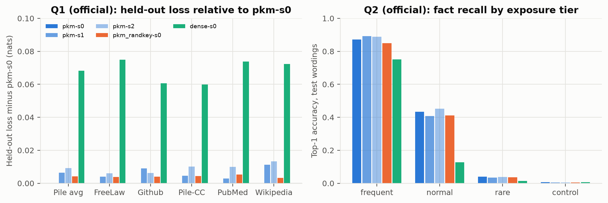
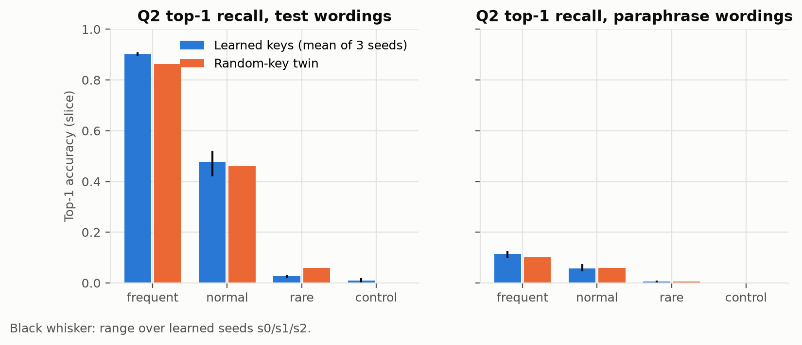
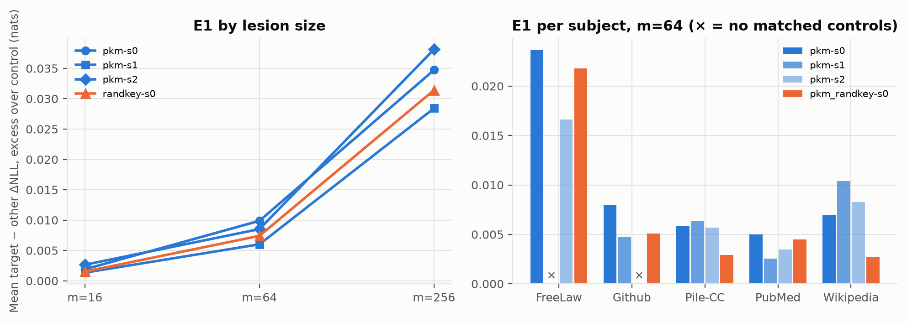
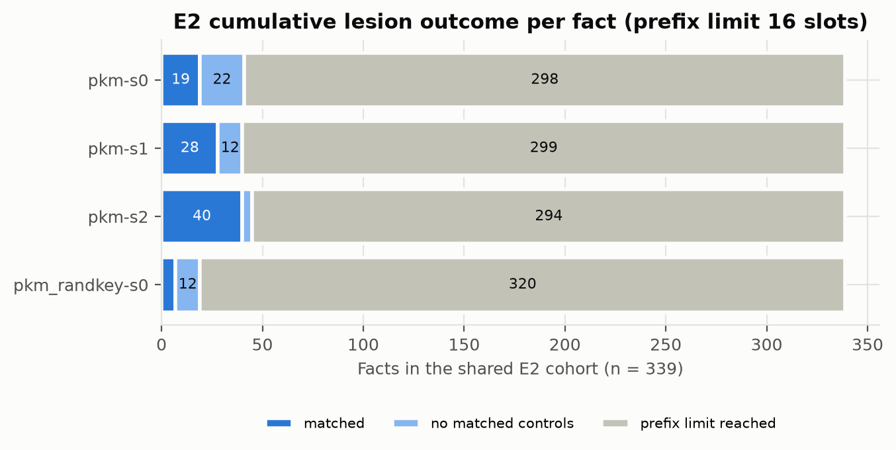
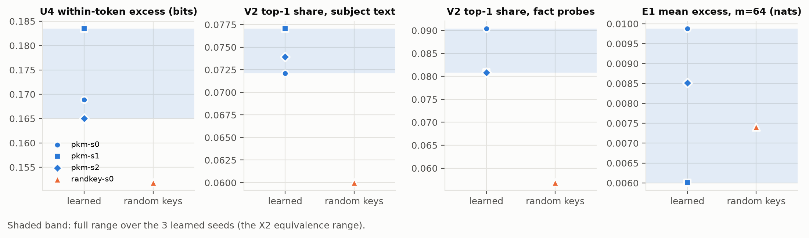
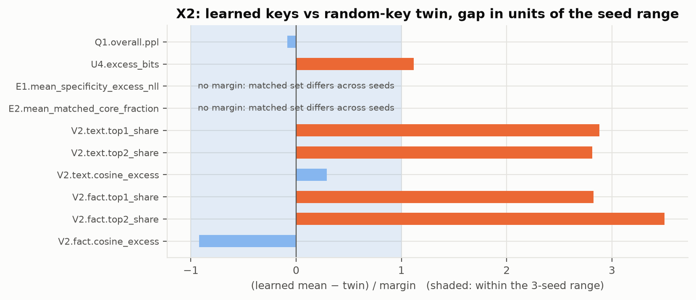
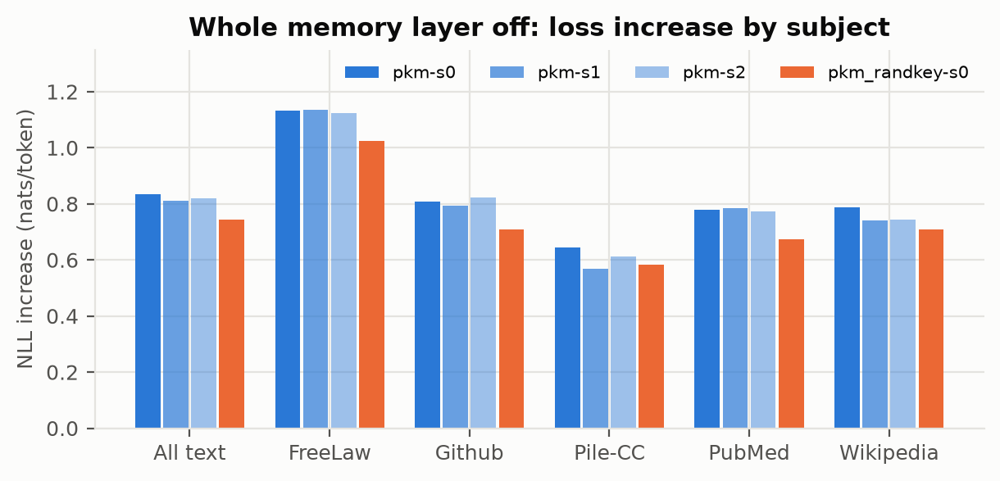

# Phase 1 metrics: pkm-s0/s1/s2, random-key twin, dense baseline (final step 9,156)

All metrics in the plan (Notion, *1. Methodology*) on the five Phase 1 checkpoints. Learned-key numbers are given per seed and as the mean [min, max] over s0/s1/s2. That range is the plan's error bar, and also the X2 equivalence margin. Figures are in `reports/final_metrics/`, and the numbers behind them are in `reports/final_metrics/digest.json`.

## Summary

- **Training checks.** David's official `training_check.json` passes for pkm-s0, pkm-s1, pkm_randkey-s0 and dense-s0. **pkm-s2 fails `no_divergence`**: its training loss reached 1.535× its running minimum at step 9,050, against a limit of 1.5. The other runs peak at 1.41–1.48. Its held-out loss and fact recall match s0 and s1. As Roie decided, s2 stays in the 3-seed analysis with this flag.
- **Q1 (official).** At equal compute, every PKM run beats dense: Pile-average held-out loss is 3.739–3.748 for PKM vs 3.807 for dense (perplexity 42.0–42.4 vs 45.0). The random-key twin (3.743) sits inside the learned-seed range.
- **Q2 (official).** On test wordings, frequent-tier top-1 is 0.871–0.892 for learned keys, 0.850 for the twin and 0.751 for dense. Normal-tier top-1 is 0.41–0.45 for PKM and 0.13 for dense. Control (never trained) is 0.005–0.006 for all.
- **H1 (U4, E1).** Slot use is subject-specific within the same token: U4 excess is 0.165–0.184 bits over shuffled labels, p = 0.01 (the smallest possible with 99 permutations). Removing a subject's top-64 slots hurts that subject more than matched control slots do in every matched case, though the effect is small: a mean excess of 0.006–0.010 nats.
- **H2 (E2).** Most facts are **not** erased by removing the 16 slots they read most: 294–299 of the 339 cohort facts reach the prefix limit. Of the facts that are erased (19–40), the core set is about 2–3% of the slots the fact reads.
- **H4 (V2).** No single value dominates a read. The top-1 value carries 7–9% of the output norm and the top-2 values 12–15%. Co-read values are slightly more aligned than norm-matched random pairs, by a cosine excess of 0.010–0.018.
- **H3 (X2).** Q1 and the V2 cosine excess are within the 3-seed range. U4 excess and all four V2 share numbers are outside it, all in the predicted direction (learned keys are more subject-specific and more concentrated). U4 lies only just outside, at 1.1× the margin. The tool gives **no X2 verdict for E1 and E2**, because the set of matched subjects or facts differs across the learned seeds.

## Setup

- **Code.** `main` (PR 6) plus three fixes on branch `claude/project-thread-g4yifr`, each with a test:
  1. **C6 on MPS.** On MPS, `.to(device="cpu", dtype=float64)` returned zeros, so the rank came out empty or wrong. Rows are now copied to the CPU before the cast.
  2. **Parity rank flips.** A native rank flip with all scores inside tolerance now gets the same float64 recheck as a score failure. This triggered on randkey: 2 birth-date paraphrase rows near rank 150, with a maximum score error of 8.6e-6.
  3. **X2 twin form.** The twin is now compared in its JSON form. A tuple-vs-list mismatch in the Adam betas made X2 reject the twin.
- **Slice and settings.** Slice seed 17, with 80 frequent-tier people (E2) and 10 per other tier. Q1 uses 64 docs per subject × 256 tokens on the test half, and U4 uses the same on the discovery half. E1 uses m = 64 as the headline plus 16 and 256, 3 controls and a 16-slot prefix limit. All runs used `--device mps`.
- **Device check.** The MPS reports for s0, s1 and s2 match the CPU pilot reports to float rounding. Q1, Q2, U1, U4, C4 and C6 agree within 0.1% relative and V2 within 0.6%. E2 core sets and statuses are identical; only some matched-control draws differ, because near-equal profiles round differently.
- **E2 cohort.** The cohort is the 339 facts that all four PKM checkpoints recall on discovery and test, out of 400 sampled. It is fixed with `--e2-facts`, and every E2 number below is on it. Each checkpoint still finds its own slots.
- **Official vs slice.** The official Q1 and Q2 are the training runs' own `heldout_quality` and `fact_recall` at the final step, uploaded by David: the whole test half and every fact. The slice Q1 and Q2 are the baseline for the lesion tests only.

## Baseline quality (Q1, Q2)

| Official, final step | pkm-s0 | pkm-s1 | pkm-s2 | randkey-s0 | dense-s0 |
|---|---|---|---|---|---|
| Training check | pass | pass | **fail** (no_divergence 1.535) | pass | pass |
| Pile avg held-out loss | 3.739 | 3.745 | 3.748 | 3.743 | 3.807 |
| Pile avg perplexity | 42.04 | 42.31 | 42.42 | 42.22 | 45.01 |
| Next-token top-1 | 0.4149 | 0.4142 | 0.4141 | 0.4144 | 0.4078 |
| USPTO perplexity (untrained subject) | 92.0 | 94.1 | 93.1 | 92.2 | 98.1 |
| Q2 top-1, frequent / test | 0.871 | 0.892 | 0.889 | 0.850 | 0.751 |
| Q2 top-1, normal / test | 0.433 | 0.407 | 0.452 | 0.412 | 0.127 |
| Q2 top-1, rare / test | 0.040 | 0.035 | 0.039 | 0.036 | 0.014 |
| Q2 top-1, control / test | 0.006 | 0.005 | 0.005 | 0.005 | 0.006 |
| Q2 top-1, frequent / paraphrase | 0.109 | 0.118 | 0.108 | 0.095 | 0.102 |
| Q2 rank, frequent / paraphrase (control) | 64.2 (105.3) | 63.7 (105.1) | 65.7 (106.1) | 61.6 (105.5) | 65.9 (105.6) |

Paraphrase recall stays low (about 0.1 top-1 for frequent people), but the true value still ranks well above the controls (about 64 vs 105). This matches the data-check note in the plan: the model stores "person in this kind of sentence → value", not a wording-free fact.

Q2 on the analysis slice gives the same picture: frequent/test is 0.902 [0.895, 0.909] for learned keys and 0.864 for the twin.

## H1: subject specificity (U4, E1)

| | s0 | s1 | s2 | learned mean [range] | randkey |
|---|---|---|---|---|---|
| U4 conditional MI (bits) | 0.637 | 0.649 | 0.637 | 0.641 [0.637, 0.649] | 0.622 |
| U4 shuffled mean (bits) | 0.469 | 0.466 | 0.472 | 0.469 [0.466, 0.472] | 0.471 |
| **U4 excess (bits)** | 0.1689 | 0.1835 | 0.1651 | **0.1725 [0.1651, 0.1835]** | 0.1519 |
| U4 permutation p | 0.01 | 0.01 | 0.01 | | 0.01 |
| E1 mean excess, m = 16 (nats) | 0.0019 | 0.0013 | 0.0026 | 0.0020 [0.0013, 0.0026] | 0.0015 |
| **E1 mean excess, m = 64 (headline)** | 0.0099 | 0.0060 | 0.0085 | **0.0081 [0.0060, 0.0099]** | 0.0074 |
| E1 mean excess, m = 256 | 0.0347 | 0.0284 | 0.0381 | 0.0338 [0.0284, 0.0381] | 0.0314 |
| E1 subjects matched (m = 64) | 5 | 4 | 4 | | 5 |

**E1 per subject, m = 64** (excess over matched control, nats; — = no matched controls, so it is left out of that seed's mean):

| Subject | s0 | s1 | s2 | randkey |
|---|---|---|---|---|
| FreeLaw | 0.0237 | — | 0.0166 | 0.0218 |
| Github | 0.0079 | 0.0047 | — | 0.0051 |
| Pile-CC | 0.0058 | 0.0064 | 0.0057 | 0.0029 |
| PubMed Central | 0.0050 | 0.0025 | 0.0035 | 0.0045 |
| Wikipedia (en) | 0.0070 | 0.0104 | 0.0083 | 0.0027 |

s1 has no FreeLaw value and s2 has no Github value: none of the 3 control draws matched those subjects' top slots on read count and value norm. FreeLaw has the largest effect wherever it is measured, so s1's mean (0.0060) is low partly because FreeLaw is missing. On s1's four subjects, s0 averages 0.0064, against s1's 0.0060.

**Sampling noise.** In the sample-size pilot at this slice size, the E1 m = 64 seed values were only about 2.3× the s0 sampling spread (redrawing docs). So part of the E1 seed range above is sampling noise, not seed-to-seed difference. U4 was at the pilot's threshold (sampling about 1/3 of the seed spread).

## H2: fact core sets (E2)

| On the 339-fact cohort | s0 | s1 | s2 | learned mean [range] | randkey |
|---|---|---|---|---|---|
| **Matched facts** | 19 | 28 | 40 | 29 [19, 40] | 7 |
| No matched controls | 22 | 12 | 5 | 13 [5, 22] | 12 |
| Prefix limit (16 slots) reached | 298 | 299 | 294 | 297 [294, 299] | 320 |
| Mean core fraction (matched facts) | 0.022 | 0.025 | 0.030 | 0.026 [0.022, 0.030] | 0.030 |
| Mean control erasure rate (matched facts) | 0.035 | 0.024 | 0.067 | 0.042 [0.024, 0.067] | 0.095 |

- **How to read it.** For 87–88% of facts, removing the 16 most-read slots does not bring recall to chance. These facts are not stored in a small set of the slots they read, at least not within 16 slots.
- **Matched facts.** Where a core set is found (19–40 facts per seed), it is about 2–3% of the slots the fact reads, and matched random read slots rarely erase the fact (erasure rate 2–7%). That is the "few dedicated slots" pattern, but only for a minority of facts.
- **Twin.** The random-key twin has far fewer facts with a core set inside 16 slots: 7, against 19–40.
- **Caveat.** The matched counts are small, and the pilot found E2's sampling spread larger than a third of its seed spread (ratio about 1.6). The E2 seed range above is therefore mostly sampling noise. The binding limit is the 16-slot prefix, not the number of people.
- **Single-slot check.** On this cohort it removed the highest-mass slot of p001604 / university on each seed. The gold log-prob drop on the test wordings was 0.000, 0.003 and -0.000 nats for s0, s1 and s2, all within the matched controls. No single slot carries this fact.

## H4: how a read uses its values (V2)

| | s0 | s1 | s2 | learned mean [range] | randkey |
|---|---|---|---|---|---|
| Top-1 share, subject text | 0.0721 | 0.0771 | 0.0739 | 0.0744 [0.0721, 0.0771] | 0.0600 |
| Top-2 share, subject text | 0.1202 | 0.1283 | 0.1229 | 0.1238 [0.1202, 0.1283] | 0.1011 |
| Cosine excess over norm-matched pairs, text | 0.0169 | 0.0179 | 0.0169 | 0.0172 [0.0169, 0.0179] | 0.0170 |
| Top-1 share, fact probes | 0.0904 | 0.0809 | 0.0808 | 0.0841 [0.0808, 0.0904] | 0.0569 |
| Top-2 share, fact probes | 0.1494 | 0.1367 | 0.1364 | 0.1408 [0.1364, 0.1494] | 0.0954 |
| Cosine excess, fact probes | 0.0104 | 0.0104 | 0.0101 | 0.0103 [0.0101, 0.0104] | 0.0106 |

The top-1 value carries 7–9% of a read's output norm and the top two 12–15%: a read is built from many values, not dominated by one or two. Co-read values are slightly aligned, with the same small cosine excess in the twin.

## H3: learned vs random keys (X2)

The margins were locked from the three learned cohort reports (`runs/final/x2-margins.json`) before the twin was scored. The rule is that the twin counts as the same if |learned mean − twin| ≤ the full learned range.

| Metric | Learned mean | Twin | Margin | Gap / margin | Same? |
|---|---|---|---|---|---|
| Q1 slice perplexity | 34.771 | 34.801 | 0.365 | −0.08 | yes |
| U4 excess (bits) | 0.1725 | 0.1519 | 0.0185 | 1.12 | no (near edge) |
| E1 mean excess, m = 64 | — | 0.0074 | — | — | no verdict: matched subjects differ across seeds |
| E2 mean core fraction | — | 0.0298 | — | — | no verdict: matched facts differ across seeds |
| V2 top-1 share, text | 0.0744 | 0.0600 | 0.0050 | 2.88 | no |
| V2 top-2 share, text | 0.1238 | 0.1011 | 0.0081 | 2.81 | no |
| V2 cosine excess, text | 0.0172 | 0.0170 | 0.0010 | 0.29 | yes |
| V2 top-1 share, facts | 0.0841 | 0.0569 | 0.0096 | 2.82 | no |
| V2 top-2 share, facts | 0.1408 | 0.0954 | 0.0130 | 3.50 | no |
| V2 cosine excess, facts | 0.0103 | 0.0106 | 0.0003 | −0.92 | yes |

- **What learned keys add.** Every gap outside the margin is in the predicted direction. Learned keys concentrate reads more (V2 shares, 2.8–3.5× the margin) and are a little more subject-specific (U4, 1.1× the margin). Quality (Q1) is the same.
- **U4 near the edge.** The plan says to add 1–2 twin seeds before deciding when the twin is this close to the edge.
- **E1 and E2.** The tool gives no verdict for these two, by design, because each seed is averaged over a different matched set. Descriptively, the twin's E1 m = 64 (0.0074) is inside the learned range [0.0060, 0.0099]. Its E2 core fraction (0.030) is at the top of the learned range [0.022, 0.030], but it rests on 7 facts.
- **Training checks.** The X2 file lists them as `None`, because these reports were made before David's upload. The verdicts are in the Q1 table above.

## Diagnostics (U1, C4, C6) and whole-layer removal

| | s0 | s1 | s2 | randkey |
|---|---|---|---|---|
| U1 slots selected | 99.93% | 99.94% | 99.96% | 99.97% |
| U1 slots ever top-ranked | 21.3% | 22.4% | 22.3% | 19.8% |
| U1 KL to uniform (bits) | 0.734 | 0.718 | 0.710 | 0.779 |
| C6 effective rank, active rows | 366.4 | 366.4 | 366.3 | 366.1 |
| C6 effective rank, 512 most-read rows | 313.7 | 315.2 | 313.5 | 314.4 |
| Whole layer off: ΔNLL all text (nats/token) | 0.835 | 0.811 | 0.821 | 0.743 |
| Whole layer off: frequent/test top-1 (intact → off) | 0.895 → 0.314 | 0.909 → 0.315 | 0.903 → 0.270 | 0.864 → 0.295 |

- **C6 vs dense.** On 896 sampled rows (the dense layer's row count), pkm-s0's value table has an effective rank of 342.0 and the dense FFN output matrix 334.8. The value table sits close to a dense matrix of the same size: about 342 of 384 dimensions for both.
- **C4.** The slot inspections (logit lens and top contexts) are in each HTML report. The most-read slots push up function words and punctuation (`the`, `and`, `of`, `,`), which is token-level rather than topic-level content.

Switching the memory layer off costs 0.81–0.84 nats/token on learned keys and 0.74 on the twin, with FreeLaw hit hardest (1.12–1.14). It removes about two thirds of frequent-tier fact recall.

## Dense baseline (dense-s0)

The dense run passes parity and its training check. It has no memory layer, so only Q1, Q2 and resources apply, as the plan specifies. The analysis took 74 s.

| Slice (same 64 docs / 80 people) | pkm-s0 | dense-s0 |
|---|---|---|
| Q1 NLL, all text | 3.542 | 3.622 |
| Q1 NLL, FreeLaw / Github / Pile-CC / PubMed / Wikipedia | 2.45 / 2.73 / 4.95 / 3.65 / 4.13 | 2.55 / 2.80 / 5.02 / 3.72 / 4.21 |
| Q2 top-1, frequent / test | 0.895 | 0.775 |
| Q2 top-1, normal / test | 0.49 | 0.05 |
| Q2 mean rank, normal / test | 13.0 | 31.7 |
| Checkpoint size (MiB) | 209.0 | 113.1 |
| Prefill latency, batch 1 on MPS (ms) | 3.83 | 3.07 |
| Prefill throughput on MPS (tokens/s) | 66,781 | 83,394 |

- **Quality.** At equal compute per token, the memory gains 0.08 nats/token on the slice, and 0.06–0.07 on the official full test half. It also lifts normal-tier fact recall from near zero (0.05 on the slice, 0.13 official) to about 0.45.
- **Cost.** The memory adds 96 MiB of parameters. Latency on this Mac is 25% higher. MPS timings are indicative only, not GPU numbers.

## Files

- **Final reports (HTML + JSON):** `runs/final/cohort/<run>/` for the four PKM runs and `runs/final/dense-s0/` for dense. Pass-1 reports (before the E2 cohort) are in `runs/final/<run>/`.
- **Inputs:** the E2 cohort is `runs/final/e2-cohort.json`, the X2 margins are `runs/final/x2-margins.json`, and the official training metrics are in `runs/final/hf_meta/`.
- **Scripts:** `runs/final/pipeline.sh` (the run order) and `reports/build_final_metrics_figures.py` (the figures).
