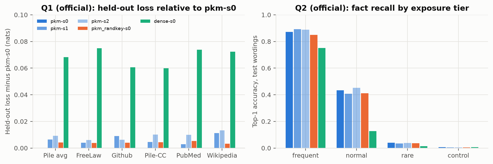
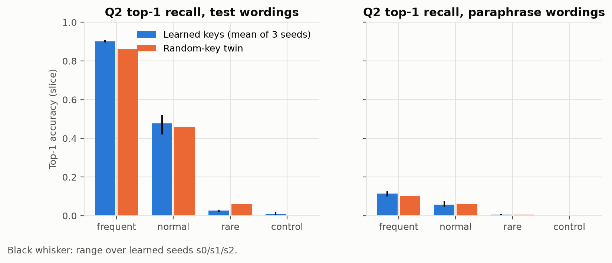
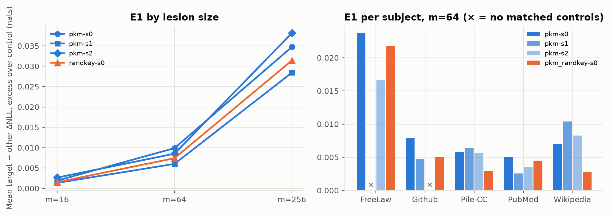
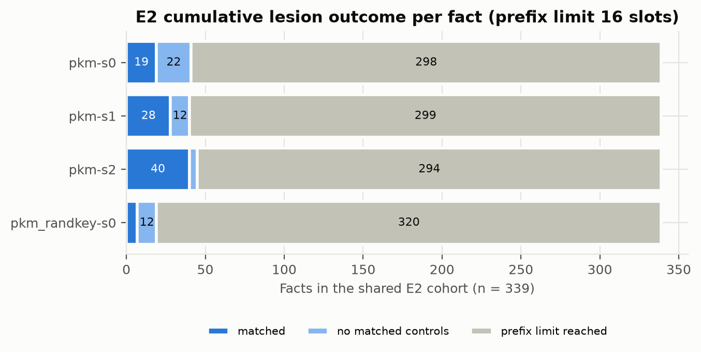
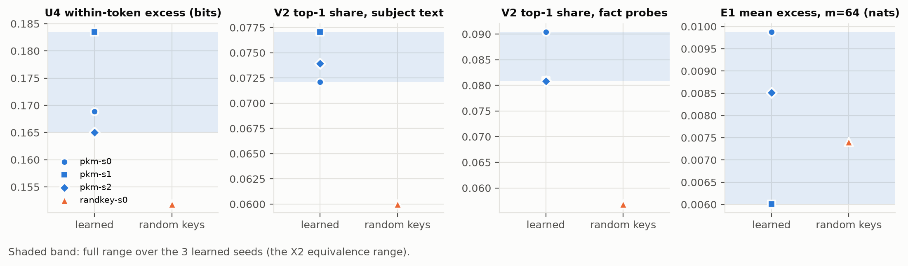
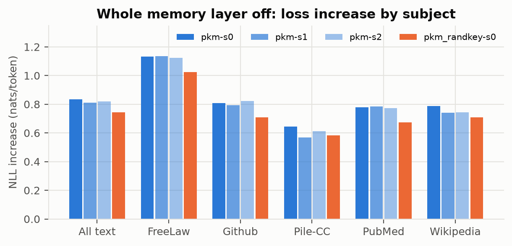
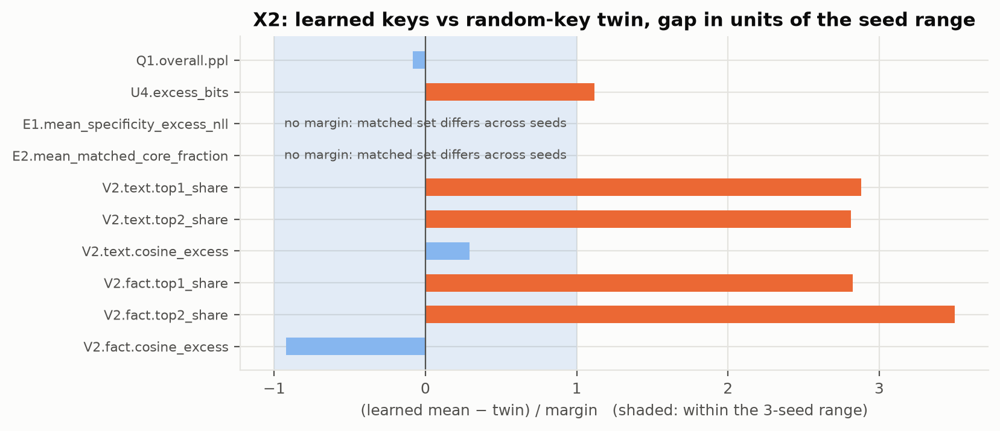

# Phase 1 metric results (final step 9,156)

**Checkpoints:**
- pkm-s0, pkm-s1, pkm-s2: learned keys, 3 seeds.
- pkm_randkey-s0: keys frozen at their random initialization.
- dense-s0: no memory layer, the same compute per token.

**Two sources of numbers:**
- **Official** numbers come from each training run's own final evaluation, covering the whole held-out test half and every fact.
- **Slice** numbers come from `metrics.py` on a fixed sample: slice seed 17; 64 documents × 256 tokens per subject; 80 frequent-tier people and 10 per other tier; every wording of 5 attributes. For E2, a shared cohort of 339 facts.

"Learned" means mean [min, max] over s0/s1/s2. All raw values are in `raw_results.csv`.

## Training check

Each run's own check of finite loss, no divergence, learning, no rising loss, slot coverage and fact recall.

| | pkm-s0 | pkm-s1 | pkm-s2 | randkey-s0 | dense-s0 |
|---|---|---|---|---|---|
| Verdict | pass | pass | fail | pass | pass |
| Worst loss / running minimum (limit 1.5) | 1.473 | 1.411 | 1.535 (step 9,050) | 1.475 | 1.464 |

## Q1: held-out next-token quality

Loss (nats/token), perplexity and top-1 next-token accuracy on held-out text, per subject.

| Official | pkm-s0 | pkm-s1 | pkm-s2 | randkey-s0 | dense-s0 |
|---|---|---|---|---|---|
| Pile avg loss | 3.739 | 3.745 | 3.748 | 3.743 | 3.807 |
| Pile avg perplexity | 42.04 | 42.31 | 42.42 | 42.22 | 45.01 |
| Pile avg top-1 | 0.4149 | 0.4142 | 0.4141 | 0.4144 | 0.4078 |
| FreeLaw loss | 3.383 | 3.387 | 3.389 | 3.387 | 3.458 |
| Github loss | 2.422 | 2.431 | 2.428 | 2.426 | 2.482 |
| Pile-CC loss | 4.870 | 4.875 | 4.880 | 4.875 | 4.930 |
| PubMed Central loss | 3.576 | 3.579 | 3.586 | 3.581 | 3.650 |
| Wikipedia loss | 4.444 | 4.455 | 4.458 | 4.447 | 4.516 |
| USPTO loss (subject not in training) | 4.522 | 4.544 | 4.534 | 4.524 | 4.586 |

| Slice NLL (nats/token) | pkm-s0 | pkm-s1 | pkm-s2 | randkey-s0 | dense-s0 |
|---|---|---|---|---|---|
| All | 3.542 | 3.551 | 3.553 | 3.550 | 3.622 |

## Q2: fact recall

The model is given a biography prompt up to the fact. Recall is top-1 accuracy of the true value among all values of that attribute, ranked by first token. The prompts come in several wordings:
- **Test:** training-format wordings.
- **Paraphrase:** wordings never seen in training.

The exposure tiers are frequent, normal and rare. Control people never appear in training.

| Official top-1 | pkm-s0 | pkm-s1 | pkm-s2 | randkey-s0 | dense-s0 |
|---|---|---|---|---|---|
| frequent / test | 0.871 | 0.892 | 0.889 | 0.850 | 0.751 |
| normal / test | 0.433 | 0.407 | 0.452 | 0.412 | 0.127 |
| rare / test | 0.040 | 0.035 | 0.039 | 0.036 | 0.014 |
| control / test | 0.006 | 0.005 | 0.005 | 0.005 | 0.006 |
| frequent / paraphrase | 0.109 | 0.118 | 0.108 | 0.095 | 0.102 |
| Mean rank, frequent / paraphrase | 64.2 | 63.7 | 65.7 | 61.6 | 65.9 |
| Mean rank, control / paraphrase | 105.3 | 105.1 | 106.1 | 105.5 | 105.6 |

| Slice top-1 | pkm-s0 | pkm-s1 | pkm-s2 | randkey-s0 | dense-s0 |
|---|---|---|---|---|---|
| frequent / test | 0.895 | 0.909 | 0.903 | 0.864 | 0.775 |
| normal / test | 0.490 | 0.420 | 0.520 | 0.460 | 0.050 |
| rare / test | 0.030 | 0.020 | 0.030 | 0.060 | 0.020 |
| frequent / paraphrase | 0.127 | 0.115 | 0.100 | 0.103 | 0.096 |
| Answer-frequency baseline, frequent | 0.013 | 0.013 | 0.013 | 0.013 | 0.013 |

The answer-frequency baseline always guesses the attribute value that was most common in the biographies the run consumed in training.

## U1: slot usage (diagnostic)

U1 reports three numbers:
- **Selected:** the share of slots read at least once on the slice.
- **Top-ranked:** the share of slots that are ever some token's single best slot.
- **KL to uniform:** how far usage is from even.

| | pkm-s0 | pkm-s1 | pkm-s2 | randkey-s0 |
|---|---|---|---|---|
| Slots selected | 99.93% | 99.94% | 99.96% | 99.97% |
| Slots ever top-ranked | 21.3% | 22.4% | 22.3% | 19.8% |
| KL to uniform (bits) | 0.734 | 0.718 | 0.710 | 0.779 |

## U4: subject specificity within the same token

U4 is the mutual information between which slot is read and the document's subject, given the token being read, so a slot that only tracks a common word does not count. It is compared with 99 shuffles of the subject labels between whole documents. The **excess** is the real value minus the shuffle mean.

| | pkm-s0 | pkm-s1 | pkm-s2 | learned | randkey-s0 |
|---|---|---|---|---|---|
| Conditional MI (bits) | 0.637 | 0.649 | 0.637 | 0.641 [0.637, 0.649] | 0.622 |
| Shuffle mean (bits) | 0.469 | 0.466 | 0.472 | 0.469 [0.466, 0.472] | 0.471 |
| Excess (bits) | 0.1689 | 0.1835 | 0.1651 | 0.1725 [0.1651, 0.1835] | 0.1519 |
| Permutation p | 0.01 | 0.01 | 0.01 | | 0.01 |

## E1: subject removal

E1 works in four steps:
1. Switch off a subject's top-m slots, picked by U4's ranking on one half of the held-out text.
2. Measure the loss increase on that subject minus the increase on the other subjects, using the other half of the text.
3. Repeat the measurement with m matched control slots, matched on read count and value norm.
4. Report the excess over the controls. "—" means no matched control set was found for that subject, so it is left out of the mean.

| Mean excess (nats) | pkm-s0 | pkm-s1 | pkm-s2 | learned | randkey-s0 |
|---|---|---|---|---|---|
| m = 16 | 0.0019 | 0.0013 | 0.0026 | 0.0020 [0.0013, 0.0026] | 0.0015 |
| m = 64 (headline) | 0.0099 | 0.0060 | 0.0085 | 0.0081 [0.0060, 0.0099] | 0.0074 |
| m = 256 | 0.0347 | 0.0284 | 0.0381 | 0.0338 [0.0284, 0.0381] | 0.0314 |
| Subjects matched (m = 64) | 5 | 4 | 4 | | 5 |

| Per subject, m = 64 | pkm-s0 | pkm-s1 | pkm-s2 | randkey-s0 |
|---|---|---|---|---|
| FreeLaw | 0.0237 | — | 0.0166 | 0.0218 |
| Github | 0.0079 | 0.0047 | — | 0.0051 |
| Pile-CC | 0.0058 | 0.0064 | 0.0057 | 0.0029 |
| PubMed Central | 0.0050 | 0.0025 | 0.0035 | 0.0045 |
| Wikipedia (en) | 0.0070 | 0.0104 | 0.0083 | 0.0027 |

At this slice size the sample-size pilot measured the E1 (m = 64) sampling spread from redrawing docs at about 1/2.3 of the smallest seed value. Part of the seed range is therefore sampling noise.

## E2: fact core sets

E2 is run on the 339 facts that all four PKM checkpoints recall. For each fact:
- Switch off the slots the fact reads, in order of read weight, until test recall falls to chance, up to 16 slots. The slots that achieve this form the **core set**.
- **Core fraction:** the core set's size divided by the number of slots the fact reads.
- **Control erasure rate:** how often the same number of matched random read slots also erases the fact.

The statuses are:
- **Matched:** a core set and matched controls were found.
- **No matched controls:** a core set was found, but no control set matched it.
- **Prefix limit reached:** recall did not fall to chance within 16 slots.

| | pkm-s0 | pkm-s1 | pkm-s2 | learned | randkey-s0 |
|---|---|---|---|---|---|
| Matched | 19 | 28 | 40 | 29 [19, 40] | 7 |
| No matched controls | 22 | 12 | 5 | 13 [5, 22] | 12 |
| Prefix limit reached | 298 | 299 | 294 | 297 [294, 299] | 320 |
| Mean core fraction (matched) | 0.022 | 0.025 | 0.030 | 0.026 [0.022, 0.030] | 0.030 |
| Control erasure rate (matched) | 0.035 | 0.024 | 0.067 | 0.042 [0.024, 0.067] | 0.095 |

**Single-slot check.** For one fact (p001604 university), the highest-mass slot was switched off. The gold log-prob drop on the test wordings was 0.000 nats on pkm-s0, 0.003 on pkm-s1 and −0.000 on pkm-s2, against 3 matched control slots each.

At this slice size, the pilot measured E2's sampling spread at about 1.6× a third of its seed spread.

## V2: how a read uses its values

For each memory read, V2 reports:
- **Top-1 share:** the share of the output norm carried by the single largest value.
- **Top-2 share:** the same for the two largest values.
- **Cosine excess:** the mean cosine between co-read values minus that of random pairs with the same norms.

It is run on held-out subject text and on biography fact prompts.

| | pkm-s0 | pkm-s1 | pkm-s2 | learned | randkey-s0 |
|---|---|---|---|---|---|
| Top-1 share, text | 0.0721 | 0.0771 | 0.0739 | 0.0744 [0.0721, 0.0771] | 0.0600 |
| Top-2 share, text | 0.1202 | 0.1283 | 0.1229 | 0.1238 [0.1202, 0.1283] | 0.1011 |
| Cosine excess, text | 0.0169 | 0.0179 | 0.0169 | 0.0172 [0.0169, 0.0179] | 0.0170 |
| Top-1 share, facts | 0.0904 | 0.0809 | 0.0808 | 0.0841 [0.0808, 0.0904] | 0.0569 |
| Top-2 share, facts | 0.1494 | 0.1367 | 0.1364 | 0.1408 [0.1364, 0.1494] | 0.0954 |
| Cosine excess, facts | 0.0104 | 0.0104 | 0.0101 | 0.0103 [0.0101, 0.0104] | 0.0106 |

## C4: slot inspection (diagnostic)

For the most-read slots, C4 lists the tokens each value pushes up through the output matrix (logit lens) and the held-out contexts that select the slot most strongly. The full lists are in each run's HTML report. For pkm-s0, the top tokens of the six most-read slots are:

| Slot | Reads | Highest-scoring tokens |
|---|---|---|
| 53087 | 4,316 | ' the' · ' Street' · ' an' · 'estial' · ' your' |
| 59487 | 4,015 | '\\n' · ' and' · ' of' · ' (' · ' {' |
| 20162 | 3,950 | ' taken' · ' range' · ' imposed' · ' thesis' · 'ISA' |
| 13663 | 3,705 | '�' · ' office' · ').' · '*' · ')(' |
| 58284 | 3,660 | ' v' · ' ' · ' versus' · ' fuss' · 'v' |
| 36736 | 3,509 | ',' · ' in' · '.' · ' are' · ' to' |

## C6: effective rank of the value table (diagnostic)

C6 is the entropy-based effective rank, exp(entropy of the normalized singular values), of the rows of read slots. It is compared with the dense model's FFN output matrix at the same row count (896 rows; the maximum rank is 384).

| | pkm-s0 | pkm-s1 | pkm-s2 | randkey-s0 |
|---|---|---|---|---|
| All read rows | 366.4 | 366.4 | 366.3 | 366.1 |
| 512 most-read rows | 313.7 | 315.2 | 313.5 | 314.4 |
| 896 sampled rows (pkm-s0) vs dense FFN (896 rows) | 342.0 vs 334.8 | | | |

## Whole memory layer off

The whole memory layer is switched off, and the change in held-out loss and fact recall is measured on the slice.

| | pkm-s0 | pkm-s1 | pkm-s2 | randkey-s0 |
|---|---|---|---|---|
| ΔNLL, all text | 0.835 | 0.811 | 0.821 | 0.743 |
| ΔNLL, FreeLaw | 1.131 | 1.136 | 1.123 | 1.026 |
| ΔNLL, Github | 0.808 | 0.793 | 0.822 | 0.708 |
| ΔNLL, Pile-CC | 0.645 | 0.569 | 0.612 | 0.583 |
| ΔNLL, PubMed Central | 0.779 | 0.785 | 0.774 | 0.674 |
| ΔNLL, Wikipedia | 0.788 | 0.739 | 0.743 | 0.708 |
| Frequent / test top-1, intact → off | 0.895 → 0.314 | 0.909 → 0.315 | 0.903 → 0.270 | 0.864 → 0.295 |

## X2: learned vs random keys

X2 uses the plan's range rule. For each main metric, the margin is the full range over the three learned seeds, fixed before the twin was scored. The twin counts as "within" if |learned mean − twin| ≤ that margin. For E1 and E2 the tool gives no margin, because the set of matched subjects (E1) or matched facts (E2) differs between the learned seeds.

| Metric | Learned mean | Twin | Margin | (Learned − twin) / margin | Within |
|---|---|---|---|---|---|
| Q1 slice perplexity | 34.771 | 34.801 | 0.365 | −0.08 | yes |
| U4 excess (bits) | 0.1725 | 0.1519 | 0.0185 | 1.12 | no |
| E1 mean excess, m = 64 | — | 0.0074 | — | — | no margin |
| E2 mean core fraction | — | 0.0298 | — | — | no margin |
| V2 top-1 share, text | 0.0744 | 0.0600 | 0.0050 | 2.88 | no |
| V2 top-2 share, text | 0.1238 | 0.1011 | 0.0081 | 2.81 | no |
| V2 cosine excess, text | 0.0172 | 0.0170 | 0.0010 | 0.29 | yes |
| V2 top-1 share, facts | 0.0841 | 0.0569 | 0.0096 | 2.82 | no |
| V2 top-2 share, facts | 0.1408 | 0.0954 | 0.0130 | 3.50 | no |
| V2 cosine excess, facts | 0.0103 | 0.0106 | 0.0003 | −0.92 | yes |

## Resources

Batch-one prefill, measured on an Apple MPS GPU, not a CUDA GPU.

| | pkm-s0 | dense-s0 |
|---|---|---|
| Checkpoint (MiB) | 209.0 | 113.1 |
| Memory parameters (MiB) | 98.5 | 0 |
| Routed reads per token | 128 | 0 |
| Prefill latency (ms) | 3.83 | 3.07 |
| Prefill throughput (tokens/s) | 66,781 | 83,394 |
